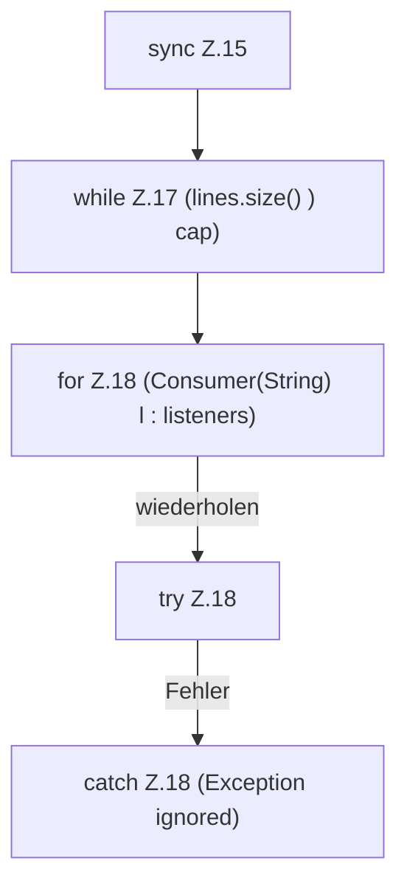

[[00 Start]] › [[Child-Prozess]] › [[Prozess-Bausteine]] › [[ConsoleBuffer]] › [[ConsoleBuffer.add]] › [[ConsoleBuffer.add.Z15]]

# ConsoleBuffer.add.Z15



```knoten
sync Z.15
  Zeile 15: synchronisierter Block.
while Z.17 (lines.size() ) cap)
  Zeile 17: Schleife `(lines.size() ) cap)`.
for Z.18 (Consumer(String) l : listeners)
  Zeile 18: Schleife `(Consumer(String) l : listeners)`.
try Z.18
  Zeile 18: Versuch. Der Fehlerpfad geht in catch.
catch Z.18 (Exception ignored)
  Zeile 18: fängt (Exception ignored).
```

> [!knoten]- Was die Blöcke tun
> - **sync Z.15**: Zeile 15: synchronisierter Block.
> - **while Z.17 (lines.size() ) cap)**: Zeile 17: Schleife `(lines.size() ) cap)`.
> - **for Z.18 (Consumer(String) l : listeners)**: Zeile 18: Schleife `(Consumer(String) l : listeners)`.
> - **try Z.18**: Zeile 18: Versuch. Der Fehlerpfad geht in catch.
> - **catch Z.18 (Exception ignored)**: Zeile 18: fängt (Exception ignored).

- Der Ablauf geht in [[Glossar#Zeile|Zeile]] 15 weiter. Eine Ebene tiefer steht er genauer.
- Fortsetzung von `ConsoleBuffer.add`.
