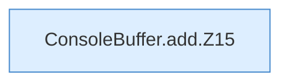

[[00 Start]] › [[Child-Prozess]] › [[Prozess-Bausteine]] › [[ConsoleBuffer]] › [[ConsoleBuffer.add]]

# ConsoleBuffer.add

`ConsoleBuffer.add(String line)` [src/main/java/de/aichele/childlauncher/ConsoleBuffer.java:15–20](https://github.com/Sciddie/minecraft-serverhoster-plugin/blob/95b02b953b0b4c23673e900e021a7c3c844aa37d/src/main/java/de/aichele/childlauncher/ConsoleBuffer.java#L15-L20)

- `add` in `src/main/java/de/aichele/childlauncher/ConsoleBuffer.java`
