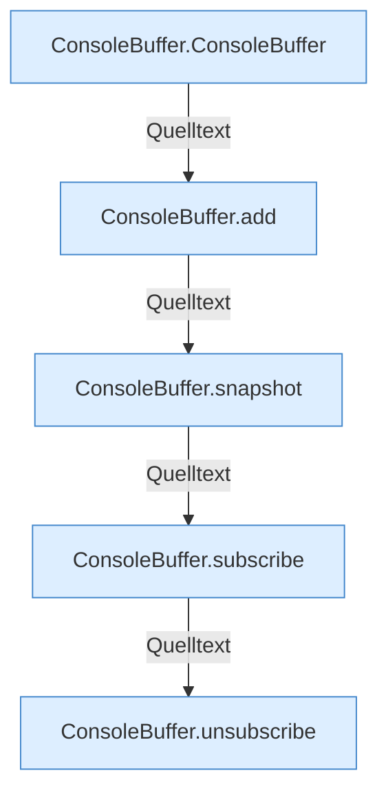

[[00 Start]] › [[Child-Prozess]] › [[Prozess-Bausteine]] › [[ConsoleBuffer]]

# ConsoleBuffer



```knoten
ConsoleBuffer.ConsoleBuffer
  Liefert die Konsole `ConsoleBuffer`.
ConsoleBuffer.add
  Fügt hinzu `add`.
ConsoleBuffer.snapshot
  `snapshot` in `ConsoleBuffer.java`.
ConsoleBuffer.subscribe
  Hängt einen Hörer an `subscribe`.
ConsoleBuffer.unsubscribe
  Hängt den Hörer ab `unsubscribe`.
```


