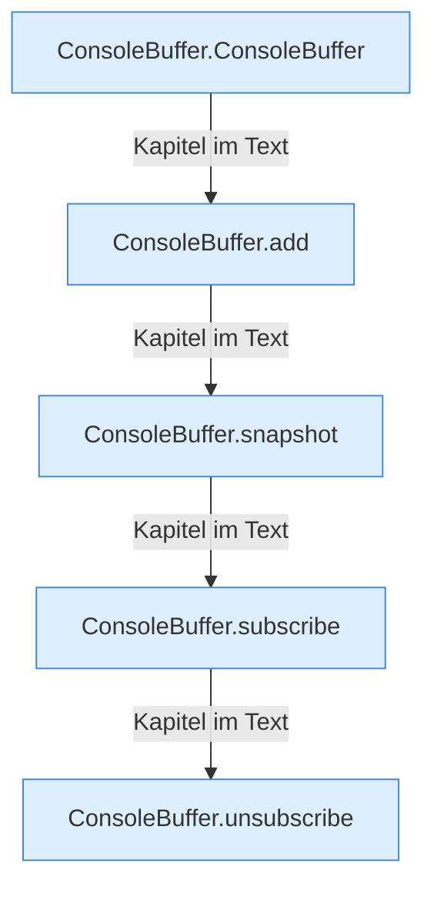

[[00 Start]] › [[Child-Prozess]] › [[Prozess-Bausteine]] › [[ConsoleBuffer]]

# ConsoleBuffer



```knoten
ConsoleBuffer.ConsoleBuffer
  Dieser Teil kümmert sich um den Zwischenspeicher. Im [[Glossar#Quelltext|Quelltext]] heißt das `ConsoleBuffer`.
ConsoleBuffer.add
  Dieser Teil fügt hinzu das. Im [[Glossar#Quelltext|Quelltext]] heißt das `add`.
ConsoleBuffer.snapshot
  Dieser Teil macht hier einen einzelnen Schritt. Eine Ebene tiefer steht er genauer. Im [[Glossar#Quelltext|Quelltext]] heißt das `snapshot`.
ConsoleBuffer.subscribe
  Dieser Teil macht hier einen einzelnen Schritt. Eine Ebene tiefer steht er genauer. Im [[Glossar#Quelltext|Quelltext]] heißt das `subscribe`.
ConsoleBuffer.unsubscribe
  Dieser Teil macht hier einen einzelnen Schritt. Eine Ebene tiefer steht er genauer. Im [[Glossar#Quelltext|Quelltext]] heißt das `unsubscribe`.
```

> [!knoten]- Was die Blöcke tun
> - **ConsoleBuffer.ConsoleBuffer**: Dieser Teil kümmert sich um den Zwischenspeicher. Im [[Glossar#Quelltext|Quelltext]] heißt das `ConsoleBuffer`.
> - **ConsoleBuffer.add**: Dieser Teil fügt hinzu das. Im [[Glossar#Quelltext|Quelltext]] heißt das `add`.
> - **ConsoleBuffer.snapshot**: Dieser Teil macht hier einen einzelnen Schritt. Eine Ebene tiefer steht er genauer. Im [[Glossar#Quelltext|Quelltext]] heißt das `snapshot`.
> - **ConsoleBuffer.subscribe**: Dieser Teil macht hier einen einzelnen Schritt. Eine Ebene tiefer steht er genauer. Im [[Glossar#Quelltext|Quelltext]] heißt das `subscribe`.
> - **ConsoleBuffer.unsubscribe**: Dieser Teil macht hier einen einzelnen Schritt. Eine Ebene tiefer steht er genauer. Im [[Glossar#Quelltext|Quelltext]] heißt das `unsubscribe`.

- Ein kurzer Speicher für die letzten [[Glossar#Zeile|Zeilen]] der [[Glossar#Konsole|Konsole]], damit die [[Glossar#Bedienseite|Bedienseite]] sie zeigen kann.
