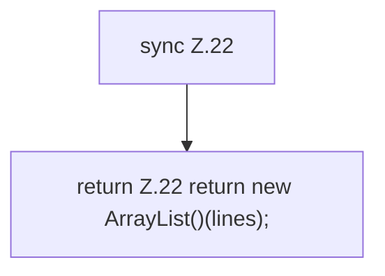

[[00 Start]] › [[Child-Prozess]] › [[Prozess-Bausteine]] › [[ConsoleBuffer]] › [[ConsoleBuffer.snapshot]]

# ConsoleBuffer.snapshot

`ConsoleBuffer.snapshot()` [src/main/java/de/aichele/childlauncher/ConsoleBuffer.java:22–22](https://github.com/Sciddie/minecraft-serverhoster-plugin/blob/95b02b953b0b4c23673e900e021a7c3c844aa37d/src/main/java/de/aichele/childlauncher/ConsoleBuffer.java#L22-L22)



```knoten
sync Z.22
  Zeile 22: synchronisierter Block.
return Z.22 return new ArrayList()(lines);
  Zeile 22: Rückgabe `return new ArrayList()(lines);`.
```

> [!knoten]- Was die Blöcke tun
> - **sync Z.22**: Zeile 22: synchronisierter Block.
> - **return Z.22 return new ArrayList()(lines);**: Zeile 22: Rückgabe `return new ArrayList()(lines);`.

- Dieser Teil macht hier einen einzelnen Schritt. Eine Ebene tiefer steht er genauer.
- `snapshot` in `src/main/java/de/aichele/childlauncher/ConsoleBuffer.java`
