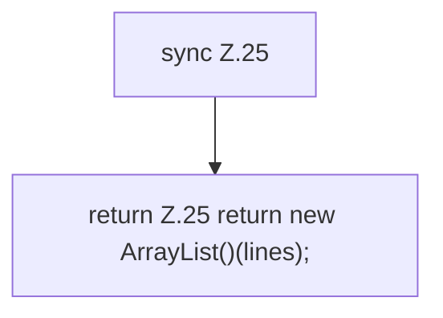

[[00 Start]] › [[Child-Prozess]] › [[Prozess-Bausteine]] › [[ConsoleBuffer]] › [[ConsoleBuffer.subscribe]]

# ConsoleBuffer.subscribe

`ConsoleBuffer.subscribe(Consumer<String> l)` [src/main/java/de/aichele/childlauncher/ConsoleBuffer.java:25–25](https://github.com/Sciddie/minecraft-serverhoster-plugin/blob/95b02b953b0b4c23673e900e021a7c3c844aa37d/src/main/java/de/aichele/childlauncher/ConsoleBuffer.java#L25-L25)



```knoten
sync Z.25
  Zeile 25: synchronisierter Block.
return Z.25 return new ArrayList()(lines);
  Zeile 25: Rückgabe `return new ArrayList()(lines);`.
```

- `subscribe` in `src/main/java/de/aichele/childlauncher/ConsoleBuffer.java`
