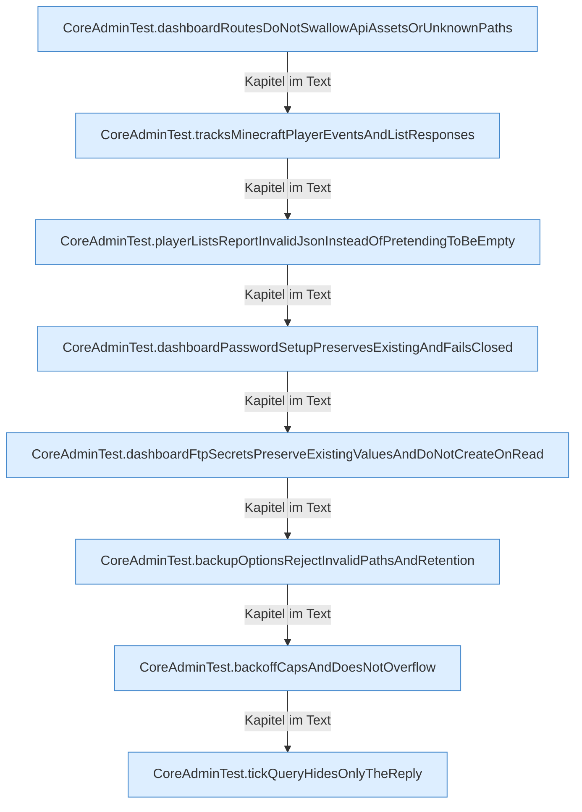

[[00 Start]] › [[Tests]] › [[CoreAdminTest]] › [[CoreAdminTest.Teil1]]

# CoreAdminTest.Teil1



```knoten
CoreAdminTest.dashboardRoutesDoNotSwallowApiAssetsOrUnknownPaths
  Ein Schritt in einem [[Glossar#Probelauf|Probelauf]]. Er gehört nicht zum laufenden Server. Im [[Glossar#Quelltext|Quelltext]] heißt das `dashboardRoutesDoNotSwallowApiAssetsOrUnknownPaths`.
CoreAdminTest.tracksMinecraftPlayerEventsAndListResponses
  Ein Schritt in einem [[Glossar#Probelauf|Probelauf]]. Er gehört nicht zum laufenden Server. Im [[Glossar#Quelltext|Quelltext]] heißt das `tracksMinecraftPlayerEventsAndListResponses`.
CoreAdminTest.playerListsReportInvalidJsonInsteadOfPretendingToBeEmpty
  Ein Schritt in einem [[Glossar#Probelauf|Probelauf]]. Er gehört nicht zum laufenden Server. Im [[Glossar#Quelltext|Quelltext]] heißt das `playerListsReportInvalidJsonInsteadOfPretendingToBeEmpty`.
CoreAdminTest.dashboardPasswordSetupPreservesExistingAndFailsClosed
  Ein Schritt in einem [[Glossar#Probelauf|Probelauf]]. Er gehört nicht zum laufenden Server. Im [[Glossar#Quelltext|Quelltext]] heißt das `dashboardPasswordSetupPreservesExistingAndFailsClosed`.
CoreAdminTest.dashboardFtpSecretsPreserveExistingValuesAndDoNotCreateOnRead
  Ein Schritt in einem [[Glossar#Probelauf|Probelauf]]. Er gehört nicht zum laufenden Server. Im [[Glossar#Quelltext|Quelltext]] heißt das `dashboardFtpSecretsPreserveExistingValuesAndDoNotCreateOnRead`.
CoreAdminTest.backupOptionsRejectInvalidPathsAndRetention
  Ein Schritt in einem [[Glossar#Probelauf|Probelauf]]. Er gehört nicht zum laufenden Server. Im [[Glossar#Quelltext|Quelltext]] heißt das `backupOptionsRejectInvalidPathsAndRetention`.
CoreAdminTest.backoffCapsAndDoesNotOverflow
  Ein Schritt in einem [[Glossar#Probelauf|Probelauf]]. Er gehört nicht zum laufenden Server. Im [[Glossar#Quelltext|Quelltext]] heißt das `backoffCapsAndDoesNotOverflow`.
CoreAdminTest.tickQueryHidesOnlyTheReply
  Ein Schritt in einem [[Glossar#Probelauf|Probelauf]]. Er gehört nicht zum laufenden Server. Im [[Glossar#Quelltext|Quelltext]] heißt das `tickQueryHidesOnlyTheReply`.
```

> [!knoten]- Was die Blöcke tun
> - **CoreAdminTest.dashboardRoutesDoNotSwallowApiAssetsOrUnknownPaths**: Ein Schritt in einem [[Glossar#Probelauf|Probelauf]]. Er gehört nicht zum laufenden Server. Im [[Glossar#Quelltext|Quelltext]] heißt das `dashboardRoutesDoNotSwallowApiAssetsOrUnknownPaths`.
> - **CoreAdminTest.tracksMinecraftPlayerEventsAndListResponses**: Ein Schritt in einem [[Glossar#Probelauf|Probelauf]]. Er gehört nicht zum laufenden Server. Im [[Glossar#Quelltext|Quelltext]] heißt das `tracksMinecraftPlayerEventsAndListResponses`.
> - **CoreAdminTest.playerListsReportInvalidJsonInsteadOfPretendingToBeEmpty**: Ein Schritt in einem [[Glossar#Probelauf|Probelauf]]. Er gehört nicht zum laufenden Server. Im [[Glossar#Quelltext|Quelltext]] heißt das `playerListsReportInvalidJsonInsteadOfPretendingToBeEmpty`.
> - **CoreAdminTest.dashboardPasswordSetupPreservesExistingAndFailsClosed**: Ein Schritt in einem [[Glossar#Probelauf|Probelauf]]. Er gehört nicht zum laufenden Server. Im [[Glossar#Quelltext|Quelltext]] heißt das `dashboardPasswordSetupPreservesExistingAndFailsClosed`.
> - **CoreAdminTest.dashboardFtpSecretsPreserveExistingValuesAndDoNotCreateOnRead**: Ein Schritt in einem [[Glossar#Probelauf|Probelauf]]. Er gehört nicht zum laufenden Server. Im [[Glossar#Quelltext|Quelltext]] heißt das `dashboardFtpSecretsPreserveExistingValuesAndDoNotCreateOnRead`.
> - **CoreAdminTest.backupOptionsRejectInvalidPathsAndRetention**: Ein Schritt in einem [[Glossar#Probelauf|Probelauf]]. Er gehört nicht zum laufenden Server. Im [[Glossar#Quelltext|Quelltext]] heißt das `backupOptionsRejectInvalidPathsAndRetention`.
> - **CoreAdminTest.backoffCapsAndDoesNotOverflow**: Ein Schritt in einem [[Glossar#Probelauf|Probelauf]]. Er gehört nicht zum laufenden Server. Im [[Glossar#Quelltext|Quelltext]] heißt das `backoffCapsAndDoesNotOverflow`.
> - **CoreAdminTest.tickQueryHidesOnlyTheReply**: Ein Schritt in einem [[Glossar#Probelauf|Probelauf]]. Er gehört nicht zum laufenden Server. Im [[Glossar#Quelltext|Quelltext]] heißt das `tickQueryHidesOnlyTheReply`.

- Ein weiterer Abschnitt derselben Übersicht.
