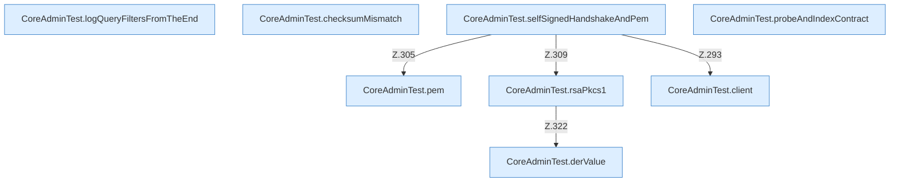

[[00 Start]] › [[Tests]] › [[CoreAdminTest]] › [[CoreAdminTest.Teil3]]

# CoreAdminTest.Teil3



```knoten
CoreAdminTest.logQueryFiltersFromTheEnd
  Ein Schritt in einem [[Glossar#Probelauf|Probelauf]]. Er gehört nicht zum laufenden Server. Im [[Glossar#Quelltext|Quelltext]] heißt das `logQueryFiltersFromTheEnd`.
CoreAdminTest.checksumMismatch
  Ein Schritt in einem [[Glossar#Probelauf|Probelauf]]. Er gehört nicht zum laufenden Server. Im [[Glossar#Quelltext|Quelltext]] heißt das `checksumMismatch`.
CoreAdminTest.selfSignedHandshakeAndPem
  Ein Schritt in einem [[Glossar#Probelauf|Probelauf]]. Er gehört nicht zum laufenden Server. Im [[Glossar#Quelltext|Quelltext]] heißt das `selfSignedHandshakeAndPem`.
CoreAdminTest.pem
  Ein Schritt in einem [[Glossar#Probelauf|Probelauf]]. Er gehört nicht zum laufenden Server. Im [[Glossar#Quelltext|Quelltext]] heißt das `pem`.
CoreAdminTest.rsaPkcs1
  Ein Schritt in einem [[Glossar#Probelauf|Probelauf]]. Er gehört nicht zum laufenden Server. Im [[Glossar#Quelltext|Quelltext]] heißt das `rsaPkcs1`.
CoreAdminTest.derValue
  Ein Schritt in einem [[Glossar#Probelauf|Probelauf]]. Er gehört nicht zum laufenden Server. Im [[Glossar#Quelltext|Quelltext]] heißt das `derValue`.
CoreAdminTest.probeAndIndexContract
  Ein Schritt in einem [[Glossar#Probelauf|Probelauf]]. Er gehört nicht zum laufenden Server. Im [[Glossar#Quelltext|Quelltext]] heißt das `probeAndIndexContract`.
CoreAdminTest.client
  Ein Schritt in einem [[Glossar#Probelauf|Probelauf]]. Er gehört nicht zum laufenden Server. Im [[Glossar#Quelltext|Quelltext]] heißt das `client`.
```

> [!knoten]- Was die Blöcke tun
> - **CoreAdminTest.logQueryFiltersFromTheEnd**: Ein Schritt in einem [[Glossar#Probelauf|Probelauf]]. Er gehört nicht zum laufenden Server. Im [[Glossar#Quelltext|Quelltext]] heißt das `logQueryFiltersFromTheEnd`.
> - **CoreAdminTest.checksumMismatch**: Ein Schritt in einem [[Glossar#Probelauf|Probelauf]]. Er gehört nicht zum laufenden Server. Im [[Glossar#Quelltext|Quelltext]] heißt das `checksumMismatch`.
> - **CoreAdminTest.selfSignedHandshakeAndPem**: Ein Schritt in einem [[Glossar#Probelauf|Probelauf]]. Er gehört nicht zum laufenden Server. Im [[Glossar#Quelltext|Quelltext]] heißt das `selfSignedHandshakeAndPem`.
> - **CoreAdminTest.pem**: Ein Schritt in einem [[Glossar#Probelauf|Probelauf]]. Er gehört nicht zum laufenden Server. Im [[Glossar#Quelltext|Quelltext]] heißt das `pem`.
> - **CoreAdminTest.rsaPkcs1**: Ein Schritt in einem [[Glossar#Probelauf|Probelauf]]. Er gehört nicht zum laufenden Server. Im [[Glossar#Quelltext|Quelltext]] heißt das `rsaPkcs1`.
> - **CoreAdminTest.derValue**: Ein Schritt in einem [[Glossar#Probelauf|Probelauf]]. Er gehört nicht zum laufenden Server. Im [[Glossar#Quelltext|Quelltext]] heißt das `derValue`.
> - **CoreAdminTest.probeAndIndexContract**: Ein Schritt in einem [[Glossar#Probelauf|Probelauf]]. Er gehört nicht zum laufenden Server. Im [[Glossar#Quelltext|Quelltext]] heißt das `probeAndIndexContract`.
> - **CoreAdminTest.client**: Ein Schritt in einem [[Glossar#Probelauf|Probelauf]]. Er gehört nicht zum laufenden Server. Im [[Glossar#Quelltext|Quelltext]] heißt das `client`.

- Ein weiterer Abschnitt derselben Übersicht.
