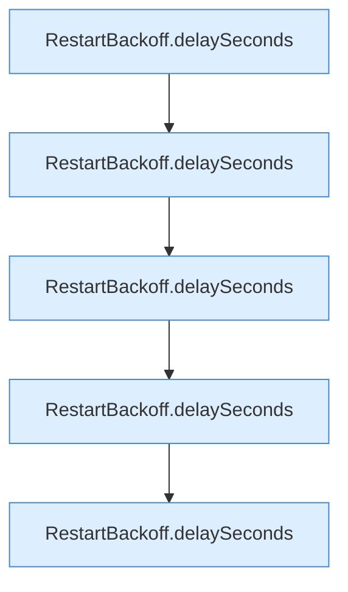

[[00 Start]] › [[Tests]] › [[CoreAdminTest]] › [[CoreAdminTest.Teil1]] › [[CoreAdminTest.backoffCapsAndDoesNotOverflow]]

# CoreAdminTest.backoffCapsAndDoesNotOverflow

`CoreAdminTest.backoffCapsAndDoesNotOverflow()` [src/test/java/de/aichele/childlauncher/CoreAdminTest.java:114–120](https://github.com/Sciddie/minecraft-serverhoster-plugin/blob/95b02b953b0b4c23673e900e021a7c3c844aa37d/src/test/java/de/aichele/childlauncher/CoreAdminTest.java#L114-L120)



```knoten
RestartBackoff.delaySeconds
  Dieser Teil macht hier einen einzelnen Schritt. Eine Ebene tiefer steht er genauer. Rechnet die Wartezeit `delaySeconds`.
```

> [!knoten]- Was die Blöcke tun
> - **RestartBackoff.delaySeconds**: Dieser Teil macht hier einen einzelnen Schritt. Eine Ebene tiefer steht er genauer. Rechnet die Wartezeit `delaySeconds`.

- Ein Schritt in einem [[Glossar#Probelauf|Probelauf]]. Er gehört nicht zum laufenden Server.
- `backoffCapsAndDoesNotOverflow` in `src/test/java/de/aichele/childlauncher/CoreAdminTest.java`
- Das ist ein Probelauf, kein Teil des laufenden Servers.
