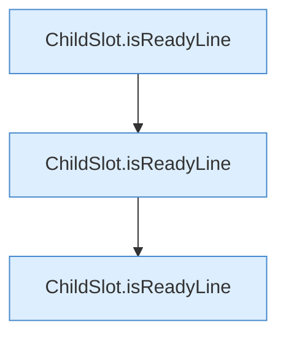

[[00 Start]] › [[Tests]] › [[CoreAdminTest]] › [[CoreAdminTest.Teil2]] › [[CoreAdminTest.childReadinessRequiresTheVanillaDoneLine]]

# CoreAdminTest.childReadinessRequiresTheVanillaDoneLine

`CoreAdminTest.childReadinessRequiresTheVanillaDoneLine()` [src/test/java/de/aichele/childlauncher/CoreAdminTest.java:136–140](https://github.com/Sciddie/minecraft-serverhoster-plugin/blob/95b02b953b0b4c23673e900e021a7c3c844aa37d/src/test/java/de/aichele/childlauncher/CoreAdminTest.java#L136-L140)



```knoten
ChildSlot.isReadyLine
  Dieser Teil prüft eine [[Glossar#Zeile|Zeile]]. Prüft `isReadyLine`.
```

> [!knoten]- Was die Blöcke tun
> - **ChildSlot.isReadyLine**: Dieser Teil prüft eine [[Glossar#Zeile|Zeile]]. Prüft `isReadyLine`.

- Ein Schritt in einem [[Glossar#Probelauf|Probelauf]]. Er gehört nicht zum laufenden Server.
- `childReadinessRequiresTheVanillaDoneLine` in `src/test/java/de/aichele/childlauncher/CoreAdminTest.java`
- Das ist ein Probelauf, kein Teil des laufenden Servers.
