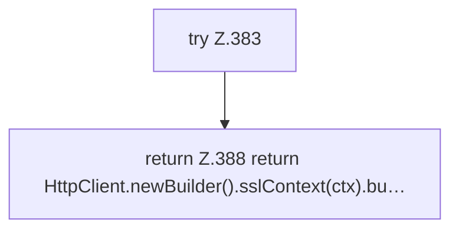

[[00 Start]] › [[Tests]] › [[CoreAdminTest]] › [[CoreAdminTest.Teil3]] › [[CoreAdminTest.client]]

# CoreAdminTest.client

`CoreAdminTest.client(Path keystore, char[] pass)` [src/test/java/de/aichele/childlauncher/CoreAdminTest.java:381–389](https://github.com/Sciddie/minecraft-serverhoster-plugin/blob/95b02b953b0b4c23673e900e021a7c3c844aa37d/src/test/java/de/aichele/childlauncher/CoreAdminTest.java#L381-L389)



```knoten
try Z.383
  Zeile 383: Versuch. Der Fehlerpfad geht in catch.
return Z.388 return HttpClient.newBuilder().sslContext(ctx).bu…
  Zeile 388: Rückgabe `return HttpClient.newBuilder().sslContext(ctx).bu…`.
```

> [!knoten]- Was die Blöcke tun
> - **try Z.383**: Zeile 383: Versuch. Der Fehlerpfad geht in catch.
> - **return Z.388 return HttpClient.newBuilder().sslContext(ctx).bu…**: Zeile 388: Rückgabe `return HttpClient.newBuilder().sslContext(ctx).bu…`.

- Ein Schritt in einem [[Glossar#Probelauf|Probelauf]]. Er gehört nicht zum laufenden Server.
- `client` in `src/test/java/de/aichele/childlauncher/CoreAdminTest.java`
- Das ist ein Probelauf, kein Teil des laufenden Servers.
