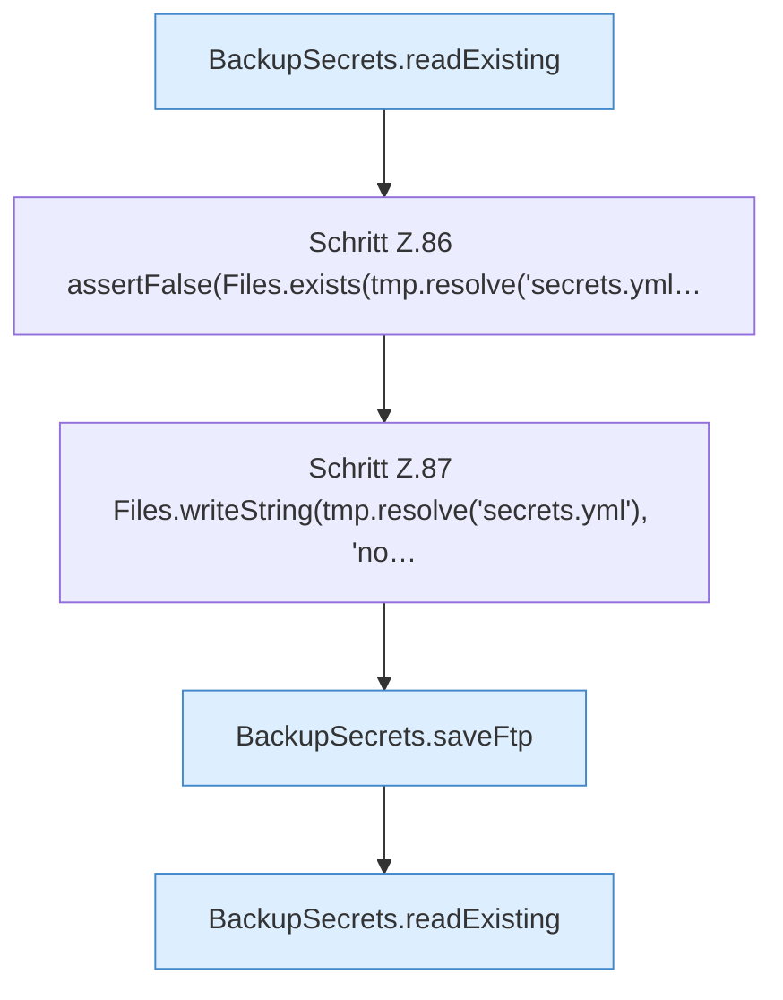

[[00 Start]] › [[Tests]] › [[CoreAdminTest]] › [[CoreAdminTest.Teil1]] › [[CoreAdminTest.dashboardFtpSecretsPreserveExistingValuesAndDoNotCreateOnRead]] › [[CoreAdminTest.dashboardFtpSecretsPreserveExistingValuesAndDoNotCreateOnRead.Teil1]]

# CoreAdminTest.dashboardFtpSecretsPreserveExistingValuesAndDoNotCreateOnRead.Teil1



```knoten
BackupSecrets.readExisting
  Liest `readExisting`. Ruft `load`.
Schritt Z.86 assertFalse(Files.exists(tmp.resolve('secrets.yml…
  Zeile 86: Dateioperation. `assertFalse(Files.exists(tmp.resolve('secrets.yml…`
Schritt Z.87 Files.writeString(tmp.resolve('secrets.yml'), 'no…
  Zeile 87: schreibt Text in eine Datei. `Files.writeString(tmp.resolve('secrets.yml'), 'no…`
BackupSecrets.saveFtp
  Speichert `saveFtp`. Ruft `load`, `restrict`.
```

- Fortsetzung von `CoreAdminTest.dashboardFtpSecretsPreserveExistingValuesAndDoNotCreateOnRead`, Quellreihenfolge.
