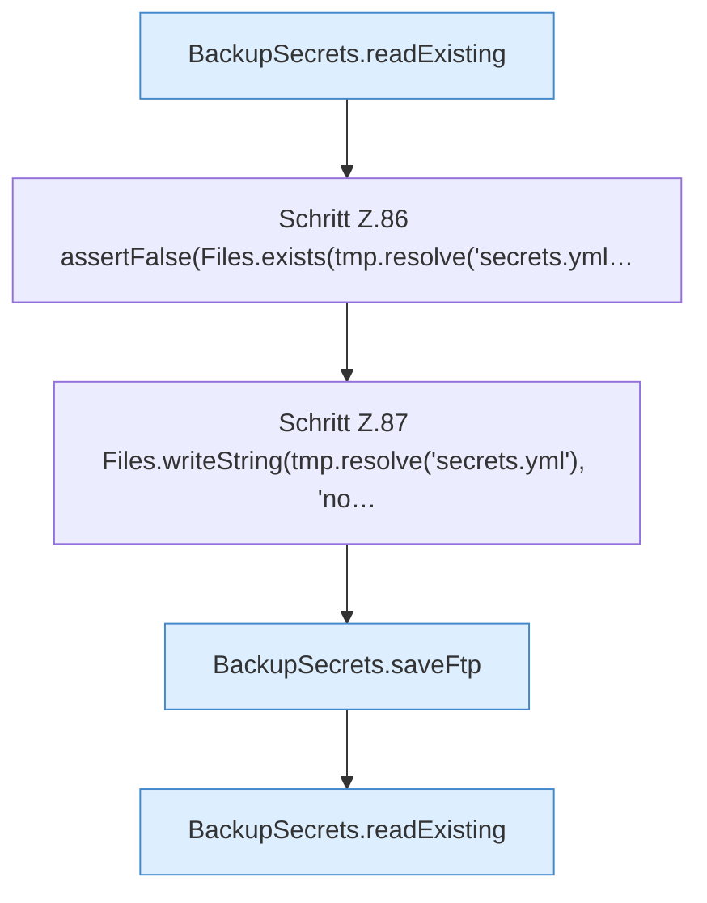

[[00 Start]] › [[Tests]] › [[CoreAdminTest]] › [[CoreAdminTest.Teil1]] › [[CoreAdminTest.dashboardFtpSecretsPreserveExistingValuesAndDoNotCreateOnRead]] › [[CoreAdminTest.dashboardFtpSecretsPreserveExistingValuesAndDoNotCreateOnRead.Teil1]]

# CoreAdminTest.dashboardFtpSecretsPreserveExistingValuesAndDoNotCreateOnRead.Teil1

- Fortsetzung von `CoreAdminTest.dashboardFtpSecretsPreserveExistingValuesAndDoNotCreateOnRead`, Quellreihenfolge.
