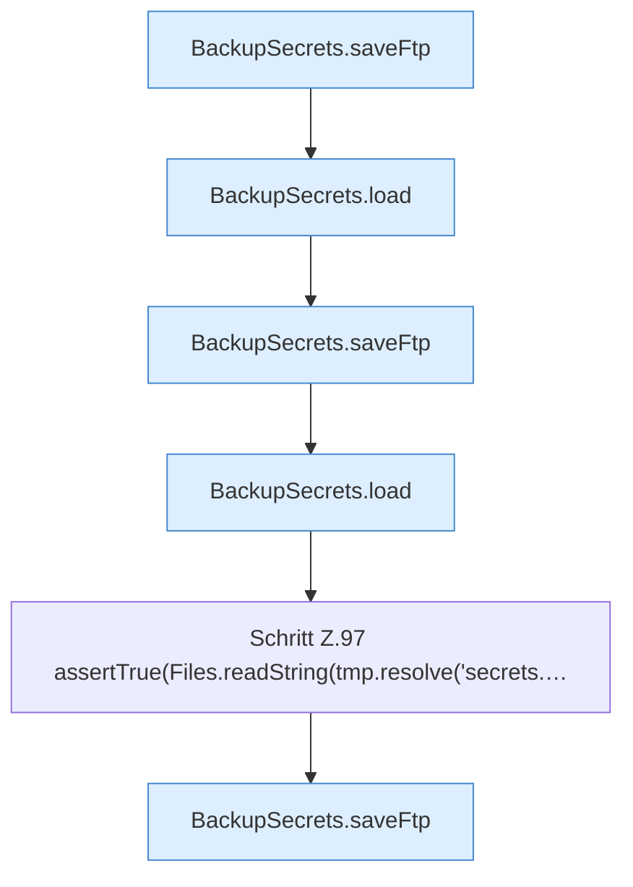

[[00 Start]] › [[Tests]] › [[CoreAdminTest]] › [[CoreAdminTest.Teil1]] › [[CoreAdminTest.dashboardFtpSecretsPreserveExistingValuesAndDoNotCreateOnRead]] › [[CoreAdminTest.dashboardFtpSecretsPreserveExistingValuesAndDoNotCreateOnRead.Teil2]]

# CoreAdminTest.dashboardFtpSecretsPreserveExistingValuesAndDoNotCreateOnRead.Teil2



```knoten
BackupSecrets.saveFtp
  Speichert `saveFtp`. Ruft `load`, `restrict`.
BackupSecrets.load
  Lädt `load`. Ruft `restrict`.
Schritt Z.97 assertTrue(Files.readString(tmp.resolve('secrets.…
  Zeile 97: liest Text aus einer Datei. `assertTrue(Files.readString(tmp.resolve('secrets.…`
```

- Fortsetzung von `CoreAdminTest.dashboardFtpSecretsPreserveExistingValuesAndDoNotCreateOnRead`, Quellreihenfolge.
