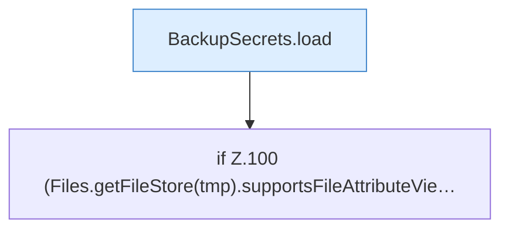

[[00 Start]] › [[Tests]] › [[CoreAdminTest]] › [[CoreAdminTest.Teil1]] › [[CoreAdminTest.dashboardFtpSecretsPreserveExistingValuesAndDoNotCreateOnRead]] › [[CoreAdminTest.dashboardFtpSecretsPreserveExistingValuesAndDoNotCreateOnRead.Teil3]]

# CoreAdminTest.dashboardFtpSecretsPreserveExistingValuesAndDoNotCreateOnRead.Teil3



```knoten
BackupSecrets.load
  Dieser Teil lädt das. Lädt `load`. Ruft `restrict`.
if Z.100 (Files.getFileStore(tmp).supportsFileAttributeVie…
  Zeile 100: prüft `(Files.getFileStore(tmp).supportsFileAttributeVie…`.
```

> [!knoten]- Was die Blöcke tun
> - **BackupSecrets.load**: Dieser Teil lädt das. Lädt `load`. Ruft `restrict`.
> - **if Z.100 (Files.getFileStore(tmp).supportsFileAttributeVie…**: Zeile 100: prüft `(Files.getFileStore(tmp).supportsFileAttributeVie…`.

- Ein weiterer Abschnitt derselben Übersicht.
- Fortsetzung von `CoreAdminTest.dashboardFtpSecretsPreserveExistingValuesAndDoNotCreateOnRead`.
