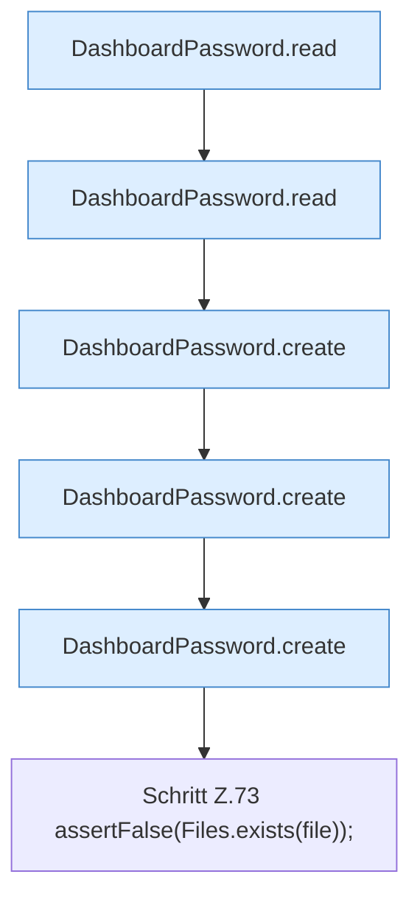

[[00 Start]] › [[Tests]] › [[CoreAdminTest]] › [[CoreAdminTest.Teil1]] › [[CoreAdminTest.dashboardPasswordSetupPreservesExistingAndFailsClosed]] › [[CoreAdminTest.dashboardPasswordSetupPreservesExistingAndFailsClosed.Teil1]]

# CoreAdminTest.dashboardPasswordSetupPreservesExistingAndFailsClosed.Teil1



```knoten
DashboardPassword.read
  Dieser Teil liest das. Liest `read`.
DashboardPassword.create
  Dieser Teil legt an das. Legt an `create`.
Schritt Z.73 assertFalse(Files.exists(file));
  Zeile 73: Dateioperation. `assertFalse(Files.exists(file));`
```

> [!knoten]- Was die Blöcke tun
> - **DashboardPassword.read**: Dieser Teil liest das. Liest `read`.
> - **DashboardPassword.create**: Dieser Teil legt an das. Legt an `create`.
> - **Schritt Z.73 assertFalse(Files.exists(file));**: Zeile 73: Dateioperation. `assertFalse(Files.exists(file));`

- Ein weiterer Abschnitt derselben Übersicht.
- Fortsetzung von `CoreAdminTest.dashboardPasswordSetupPreservesExistingAndFailsClosed`.
