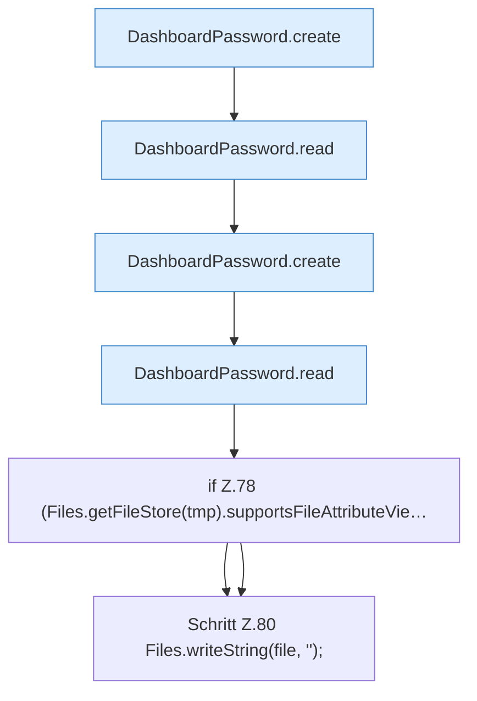

[[00 Start]] › [[Tests]] › [[CoreAdminTest]] › [[CoreAdminTest.Teil1]] › [[CoreAdminTest.dashboardPasswordSetupPreservesExistingAndFailsClosed]] › [[CoreAdminTest.dashboardPasswordSetupPreservesExistingAndFailsClosed.Teil2]]

# CoreAdminTest.dashboardPasswordSetupPreservesExistingAndFailsClosed.Teil2



```knoten
DashboardPassword.create
  Legt an `create`.
DashboardPassword.read
  Liest `read`.
if Z.78 (Files.getFileStore(tmp).supportsFileAttributeVie…
  Zeile 78: prüft `(Files.getFileStore(tmp).supportsFileAttributeVie…`.
Schritt Z.80 Files.writeString(file, '');
  Zeile 80: schreibt Text in eine Datei. `Files.writeString(file, '');`
```

- Fortsetzung von `CoreAdminTest.dashboardPasswordSetupPreservesExistingAndFailsClosed`, Quellreihenfolge.
