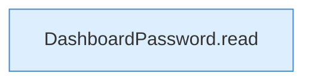

[[00 Start]] › [[Tests]] › [[CoreAdminTest]] › [[CoreAdminTest.Teil1]] › [[CoreAdminTest.dashboardPasswordSetupPreservesExistingAndFailsClosed]] › [[CoreAdminTest.dashboardPasswordSetupPreservesExistingAndFailsClosed.Teil3]]

# CoreAdminTest.dashboardPasswordSetupPreservesExistingAndFailsClosed.Teil3



```knoten
DashboardPassword.read
  Liest `read`.
```

- Fortsetzung von `CoreAdminTest.dashboardPasswordSetupPreservesExistingAndFailsClosed`, Quellreihenfolge.
