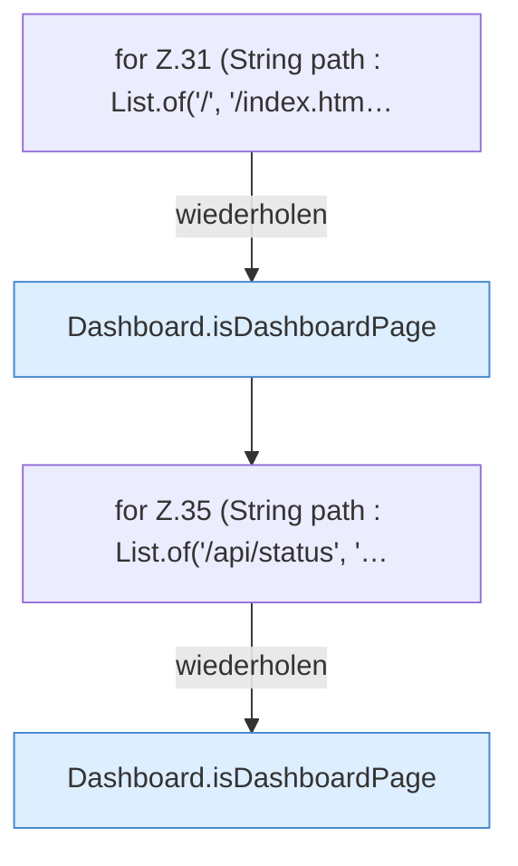

[[00 Start]] › [[Tests]] › [[CoreAdminTest]] › [[CoreAdminTest.Teil1]] › [[CoreAdminTest.dashboardRoutesDoNotSwallowApiAssetsOrUnknownPaths]]

# CoreAdminTest.dashboardRoutesDoNotSwallowApiAssetsOrUnknownPaths

`CoreAdminTest.dashboardRoutesDoNotSwallowApiAssetsOrUnknownPaths()` [src/test/java/de/aichele/childlauncher/CoreAdminTest.java:30–38](https://github.com/Sciddie/minecraft-serverhoster-plugin/blob/95b02b953b0b4c23673e900e021a7c3c844aa37d/src/test/java/de/aichele/childlauncher/CoreAdminTest.java#L30-L38)



```knoten
for Z.31 (String path : List.of('/', '/index.htm…
  Zeile 31: Schleife `(String path : List.of('/', '/index.htm…`.
Dashboard.isDashboardPage
  Prüft `isDashboardPage`.
for Z.35 (String path : List.of('/api/status', '…
  Zeile 35: Schleife `(String path : List.of('/api/status', '…`.
```

- `dashboardRoutesDoNotSwallowApiAssetsOrUnknownPaths` in `src/test/java/de/aichele/childlauncher/CoreAdminTest.java`
- Auslöser: Test
