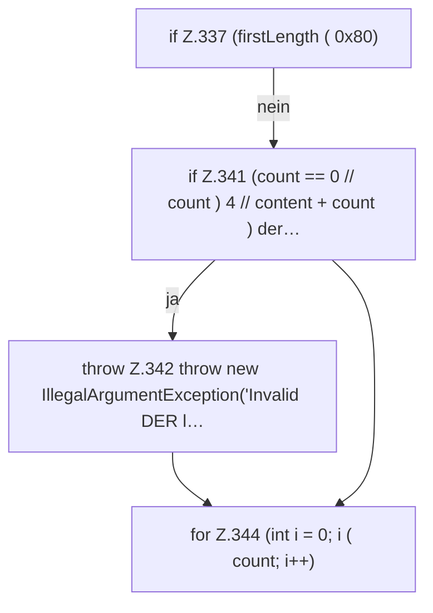

[[00 Start]] › [[Tests]] › [[CoreAdminTest]] › [[CoreAdminTest.Teil3]] › [[CoreAdminTest.derValue]] › [[CoreAdminTest.derValue.Z337]]

# CoreAdminTest.derValue.Z337

- Fortsetzung von `CoreAdminTest.derValue`, Quellreihenfolge.
