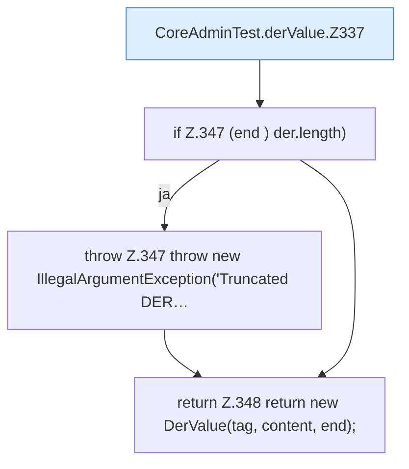

[[00 Start]] › [[Tests]] › [[CoreAdminTest]] › [[CoreAdminTest.Teil3]] › [[CoreAdminTest.derValue]]

# CoreAdminTest.derValue

`CoreAdminTest.derValue(byte[] der, int offset)` [src/test/java/de/aichele/childlauncher/CoreAdminTest.java:332–349](https://github.com/Sciddie/minecraft-serverhoster-plugin/blob/95b02b953b0b4c23673e900e021a7c3c844aa37d/src/test/java/de/aichele/childlauncher/CoreAdminTest.java#L332-L349)



```knoten
CoreAdminTest.derValue.Z337
  Der Ablauf geht in [[Glossar#Zeile|Zeile]] 337 weiter. Eine Ebene tiefer steht er genauer. Fortsetzung des Ablaufs ab Zeile 337.
if Z.347 (end ) der.length)
  Zeile 347: prüft `(end ) der.length)`.
throw Z.347 throw new IllegalArgumentException('Truncated DER…
  Zeile 347: Abbruch `throw new IllegalArgumentException('Truncated DER…`.
return Z.348 return new DerValue(tag, content, end);
  Zeile 348: Rückgabe `return new DerValue(tag, content, end);`.
```

> [!knoten]- Was die Blöcke tun
> - **CoreAdminTest.derValue.Z337**: Der Ablauf geht in [[Glossar#Zeile|Zeile]] 337 weiter. Eine Ebene tiefer steht er genauer. Fortsetzung des Ablaufs ab Zeile 337.
> - **if Z.347 (end ) der.length)**: Zeile 347: prüft `(end ) der.length)`.
> - **throw Z.347 throw new IllegalArgumentException('Truncated DER…**: Zeile 347: Abbruch `throw new IllegalArgumentException('Truncated DER…`.
> - **return Z.348 return new DerValue(tag, content, end);**: Zeile 348: Rückgabe `return new DerValue(tag, content, end);`.

- Ein Schritt in einem [[Glossar#Probelauf|Probelauf]]. Er gehört nicht zum laufenden Server.
- `derValue` in `src/test/java/de/aichele/childlauncher/CoreAdminTest.java`
- Das ist ein Probelauf, kein Teil des laufenden Servers.
