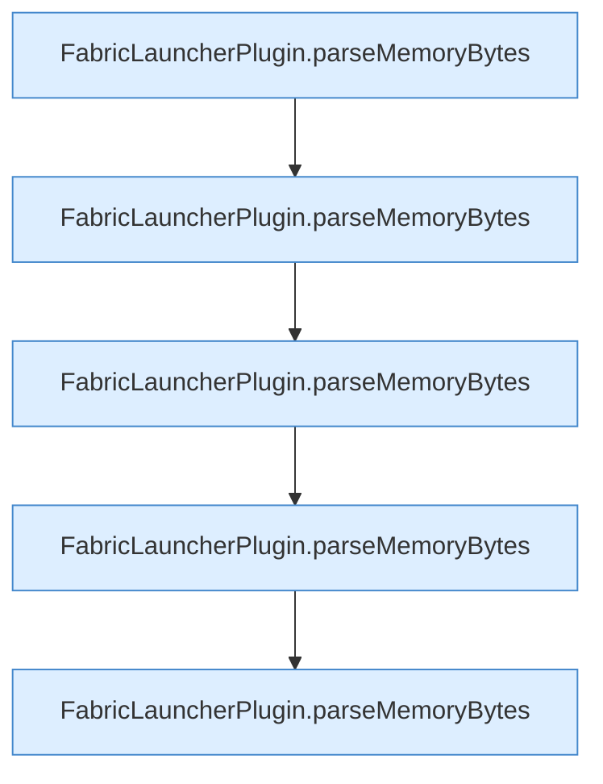

[[00 Start]] › [[Tests]] › [[CoreAdminTest]] › [[CoreAdminTest.Teil2]] › [[CoreAdminTest.heapSizeParserHandlesJvmSuffixesAndInvalidValues]]

# CoreAdminTest.heapSizeParserHandlesJvmSuffixesAndInvalidValues

`CoreAdminTest.heapSizeParserHandlesJvmSuffixesAndInvalidValues()` [src/test/java/de/aichele/childlauncher/CoreAdminTest.java:142–148](https://github.com/Sciddie/minecraft-serverhoster-plugin/blob/95b02b953b0b4c23673e900e021a7c3c844aa37d/src/test/java/de/aichele/childlauncher/CoreAdminTest.java#L142-L148)

- `heapSizeParserHandlesJvmSuffixesAndInvalidValues` in `src/test/java/de/aichele/childlauncher/CoreAdminTest.java`
- Auslöser: Test
