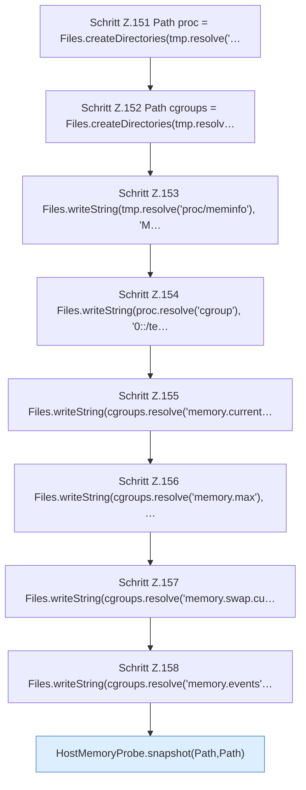

[[00 Start]] › [[Tests]] › [[CoreAdminTest]] › [[CoreAdminTest.Teil2]] › [[CoreAdminTest.hostMemoryProbeReadsCgroupV2AndHostSwapWithoutCommands]] › [[CoreAdminTest.hostMemoryProbeReadsCgroupV2AndHostSwapWithoutCommands.Teil1]]

# CoreAdminTest.hostMemoryProbeReadsCgroupV2AndHostSwapWithoutCommands.Teil1



```knoten
Schritt Z.151 Path proc = Files.createDirectories(tmp.resolve('…
  Zeile 151: Dateioperation. `Path proc = Files.createDirectories(tmp.resolve('…`
Schritt Z.152 Path cgroups = Files.createDirectories(tmp.resolv…
  Zeile 152: Dateioperation. `Path cgroups = Files.createDirectories(tmp.resolv…`
Schritt Z.153 Files.writeString(tmp.resolve('proc/meminfo'), 'M…
  Zeile 153: schreibt Text in eine Datei. `Files.writeString(tmp.resolve('proc/meminfo'), 'M…`
Schritt Z.154 Files.writeString(proc.resolve('cgroup'), '0::/te…
  Zeile 154: schreibt Text in eine Datei. `Files.writeString(proc.resolve('cgroup'), '0::/te…`
Schritt Z.155 Files.writeString(cgroups.resolve('memory.current…
  Zeile 155: schreibt Text in eine Datei. `Files.writeString(cgroups.resolve('memory.current…`
Schritt Z.156 Files.writeString(cgroups.resolve('memory.max'), …
  Zeile 156: schreibt Text in eine Datei. `Files.writeString(cgroups.resolve('memory.max'), …`
Schritt Z.157 Files.writeString(cgroups.resolve('memory.swap.cu…
  Zeile 157: schreibt Text in eine Datei. `Files.writeString(cgroups.resolve('memory.swap.cu…`
Schritt Z.158 Files.writeString(cgroups.resolve('memory.events'…
  Zeile 158: schreibt Text in eine Datei. `Files.writeString(cgroups.resolve('memory.events'…`
HostMemoryProbe.snapshot(Path,Path)
  Die Messung macht hier einen einzelnen Schritt. Eine Ebene tiefer steht er genauer. `snapshot` in `HostMemoryProbe.java`. Ruft `meminfo`, `cgroup`.
```

> [!knoten]- Was die Blöcke tun
> - **Schritt Z.151 Path proc = Files.createDirectories(tmp.resolve('…**: Zeile 151: Dateioperation. `Path proc = Files.createDirectories(tmp.resolve('…`
> - **Schritt Z.152 Path cgroups = Files.createDirectories(tmp.resolv…**: Zeile 152: Dateioperation. `Path cgroups = Files.createDirectories(tmp.resolv…`
> - **Schritt Z.153 Files.writeString(tmp.resolve('proc/meminfo'), 'M…**: Zeile 153: schreibt Text in eine Datei. `Files.writeString(tmp.resolve('proc/meminfo'), 'M…`
> - **Schritt Z.154 Files.writeString(proc.resolve('cgroup'), '0::/te…**: Zeile 154: schreibt Text in eine Datei. `Files.writeString(proc.resolve('cgroup'), '0::/te…`
> - **Schritt Z.155 Files.writeString(cgroups.resolve('memory.current…**: Zeile 155: schreibt Text in eine Datei. `Files.writeString(cgroups.resolve('memory.current…`
> - **Schritt Z.156 Files.writeString(cgroups.resolve('memory.max'), …**: Zeile 156: schreibt Text in eine Datei. `Files.writeString(cgroups.resolve('memory.max'), …`
> - **Schritt Z.157 Files.writeString(cgroups.resolve('memory.swap.cu…**: Zeile 157: schreibt Text in eine Datei. `Files.writeString(cgroups.resolve('memory.swap.cu…`
> - **Schritt Z.158 Files.writeString(cgroups.resolve('memory.events'…**: Zeile 158: schreibt Text in eine Datei. `Files.writeString(cgroups.resolve('memory.events'…`
> - **HostMemoryProbe.snapshot(Path,Path)**: Die Messung macht hier einen einzelnen Schritt. Eine Ebene tiefer steht er genauer. `snapshot` in `HostMemoryProbe.java`. Ruft `meminfo`, `cgroup`.

- Ein weiterer Abschnitt derselben Übersicht.
- Fortsetzung von `CoreAdminTest.hostMemoryProbeReadsCgroupV2AndHostSwapWithoutCommands`.
