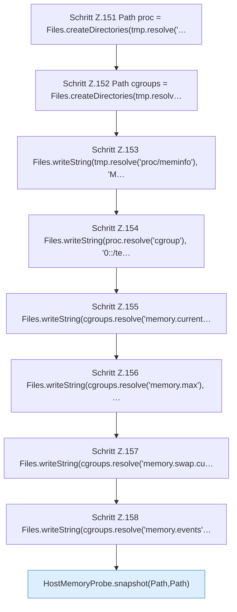

[[00 Start]] › [[Tests]] › [[CoreAdminTest]] › [[CoreAdminTest.Teil2]] › [[CoreAdminTest.hostMemoryProbeReadsCgroupV2AndHostSwapWithoutCommands]] › [[CoreAdminTest.hostMemoryProbeReadsCgroupV2AndHostSwapWithoutCommands.Teil1]]

# CoreAdminTest.hostMemoryProbeReadsCgroupV2AndHostSwapWithoutCommands.Teil1

- Fortsetzung von `CoreAdminTest.hostMemoryProbeReadsCgroupV2AndHostSwapWithoutCommands`, Quellreihenfolge.
