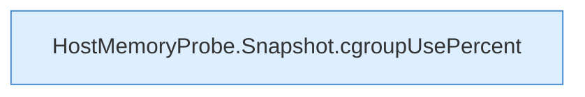

[[00 Start]] › [[Tests]] › [[CoreAdminTest]] › [[CoreAdminTest.Teil2]] › [[CoreAdminTest.hostMemoryProbeReadsCgroupV2AndHostSwapWithoutCommands]] › [[CoreAdminTest.hostMemoryProbeReadsCgroupV2AndHostSwapWithoutCommands.Teil2]]

# CoreAdminTest.hostMemoryProbeReadsCgroupV2AndHostSwapWithoutCommands.Teil2



```knoten
HostMemoryProbe.Snapshot.cgroupUsePercent
  `cgroupUsePercent` in `HostMemoryProbe.java`.
```

- Fortsetzung von `CoreAdminTest.hostMemoryProbeReadsCgroupV2AndHostSwapWithoutCommands`, Quellreihenfolge.
