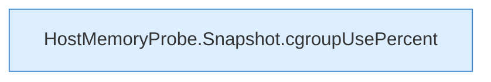

[[00 Start]] › [[Tests]] › [[CoreAdminTest]] › [[CoreAdminTest.Teil2]] › [[CoreAdminTest.hostMemoryProbeReadsCgroupV2AndHostSwapWithoutCommands]] › [[CoreAdminTest.hostMemoryProbeReadsCgroupV2AndHostSwapWithoutCommands.Teil2]]

# CoreAdminTest.hostMemoryProbeReadsCgroupV2AndHostSwapWithoutCommands.Teil2



```knoten
HostMemoryProbe.Snapshot.cgroupUsePercent
  Die Messung macht hier einen einzelnen Schritt. Eine Ebene tiefer steht er genauer. `cgroupUsePercent` in `HostMemoryProbe.java`.
```

> [!knoten]- Was die Blöcke tun
> - **HostMemoryProbe.Snapshot.cgroupUsePercent**: Die Messung macht hier einen einzelnen Schritt. Eine Ebene tiefer steht er genauer. `cgroupUsePercent` in `HostMemoryProbe.java`.

- Ein weiterer Abschnitt derselben Übersicht.
- Fortsetzung von `CoreAdminTest.hostMemoryProbeReadsCgroupV2AndHostSwapWithoutCommands`.
