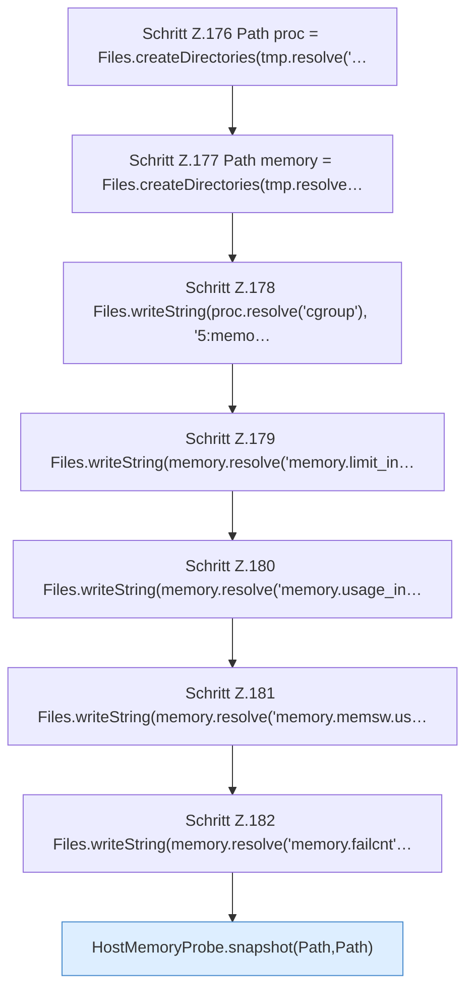

[[00 Start]] › [[Tests]] › [[CoreAdminTest]] › [[CoreAdminTest.Teil2]] › [[CoreAdminTest.hostMemoryProbeSeparatesCgroupV1LimitHitsFromOomEvents]] › [[CoreAdminTest.hostMemoryProbeSeparatesCgroupV1LimitHitsFromOomEvents.Teil1]]

# CoreAdminTest.hostMemoryProbeSeparatesCgroupV1LimitHitsFromOomEvents.Teil1



```knoten
Schritt Z.176 Path proc = Files.createDirectories(tmp.resolve('…
  Zeile 176: Dateioperation. `Path proc = Files.createDirectories(tmp.resolve('…`
Schritt Z.177 Path memory = Files.createDirectories(tmp.resolve…
  Zeile 177: Dateioperation. `Path memory = Files.createDirectories(tmp.resolve…`
Schritt Z.178 Files.writeString(proc.resolve('cgroup'), '5:memo…
  Zeile 178: schreibt Text in eine Datei. `Files.writeString(proc.resolve('cgroup'), '5:memo…`
Schritt Z.179 Files.writeString(memory.resolve('memory.limit_in…
  Zeile 179: schreibt Text in eine Datei. `Files.writeString(memory.resolve('memory.limit_in…`
Schritt Z.180 Files.writeString(memory.resolve('memory.usage_in…
  Zeile 180: schreibt Text in eine Datei. `Files.writeString(memory.resolve('memory.usage_in…`
Schritt Z.181 Files.writeString(memory.resolve('memory.memsw.us…
  Zeile 181: schreibt Text in eine Datei. `Files.writeString(memory.resolve('memory.memsw.us…`
Schritt Z.182 Files.writeString(memory.resolve('memory.failcnt'…
  Zeile 182: schreibt Text in eine Datei. `Files.writeString(memory.resolve('memory.failcnt'…`
HostMemoryProbe.snapshot(Path,Path)
  `snapshot` in `HostMemoryProbe.java`. Ruft `meminfo`, `cgroup`.
```

- Fortsetzung von `CoreAdminTest.hostMemoryProbeSeparatesCgroupV1LimitHitsFromOomEvents`, Quellreihenfolge.
