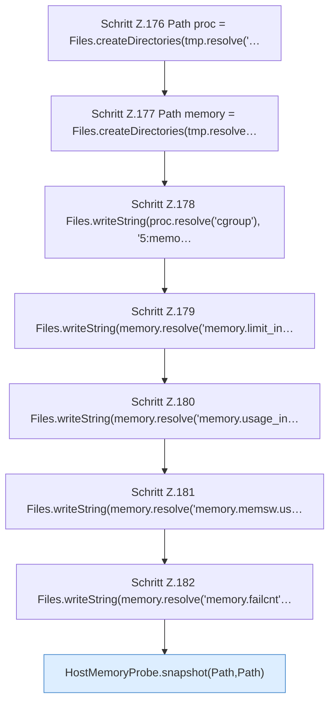

[[00 Start]] › [[Tests]] › [[CoreAdminTest]] › [[CoreAdminTest.Teil2]] › [[CoreAdminTest.hostMemoryProbeSeparatesCgroupV1LimitHitsFromOomEvents]] › [[CoreAdminTest.hostMemoryProbeSeparatesCgroupV1LimitHitsFromOomEvents.Teil1]]

# CoreAdminTest.hostMemoryProbeSeparatesCgroupV1LimitHitsFromOomEvents.Teil1

- Fortsetzung von `CoreAdminTest.hostMemoryProbeSeparatesCgroupV1LimitHitsFromOomEvents`, Quellreihenfolge.
