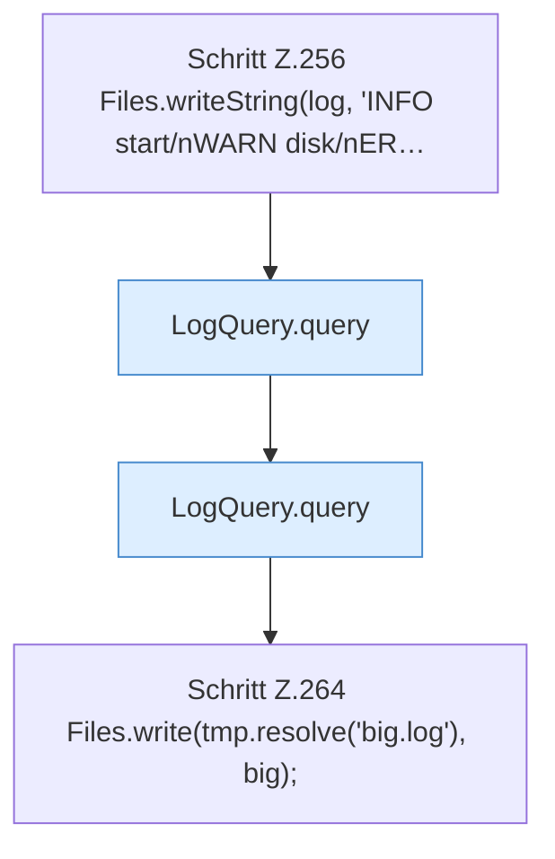

[[00 Start]] › [[Tests]] › [[CoreAdminTest]] › [[CoreAdminTest.Teil3]] › [[CoreAdminTest.logQueryFiltersFromTheEnd]] › [[CoreAdminTest.logQueryFiltersFromTheEnd.Teil1]]

# CoreAdminTest.logQueryFiltersFromTheEnd.Teil1



```knoten
Schritt Z.256 Files.writeString(log, 'INFO start/nWARN disk/nER…
  Zeile 256: schreibt Text in eine Datei. `Files.writeString(log, 'INFO start/nWARN disk/nER…`
LogQuery.query
  Fragt ab `query`. Ruft `levelOk`.
Schritt Z.264 Files.write(tmp.resolve('big.log'), big);
  Zeile 264: Dateioperation. `Files.write(tmp.resolve('big.log'), big);`
```

- Fortsetzung von `CoreAdminTest.logQueryFiltersFromTheEnd`, Quellreihenfolge.
