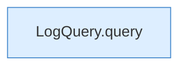

[[00 Start]] › [[Tests]] › [[CoreAdminTest]] › [[CoreAdminTest.Teil3]] › [[CoreAdminTest.logQueryFiltersFromTheEnd]] › [[CoreAdminTest.logQueryFiltersFromTheEnd.Teil2]]

# CoreAdminTest.logQueryFiltersFromTheEnd.Teil2



```knoten
LogQuery.query
  Dieser Teil fragt ab das. Fragt ab `query`. Ruft `levelOk`.
```

> [!knoten]- Was die Blöcke tun
> - **LogQuery.query**: Dieser Teil fragt ab das. Fragt ab `query`. Ruft `levelOk`.

- Ein weiterer Abschnitt derselben Übersicht.
- Fortsetzung von `CoreAdminTest.logQueryFiltersFromTheEnd`.
