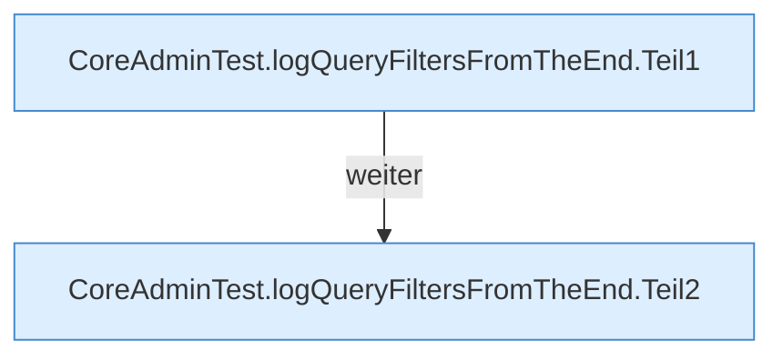

[[00 Start]] › [[Tests]] › [[CoreAdminTest]] › [[CoreAdminTest.Teil3]] › [[CoreAdminTest.logQueryFiltersFromTheEnd]]

# CoreAdminTest.logQueryFiltersFromTheEnd

`CoreAdminTest.logQueryFiltersFromTheEnd()` [src/test/java/de/aichele/childlauncher/CoreAdminTest.java:254–267](https://github.com/Sciddie/minecraft-serverhoster-plugin/blob/95b02b953b0b4c23673e900e021a7c3c844aa37d/src/test/java/de/aichele/childlauncher/CoreAdminTest.java#L254-L267)

- `logQueryFiltersFromTheEnd` in `src/test/java/de/aichele/childlauncher/CoreAdminTest.java`
- Auslöser: Test
