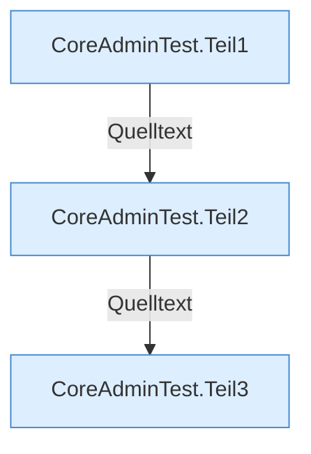

[[00 Start]] › [[Tests]] › [[CoreAdminTest]]

# CoreAdminTest



```knoten
CoreAdminTest.Teil1
  Abschnitt 1 dieses Ablaufs, in Quellreihenfolge.
CoreAdminTest.Teil2
  Abschnitt 2 dieses Ablaufs, in Quellreihenfolge.
CoreAdminTest.Teil3
  Abschnitt 3 dieses Ablaufs, in Quellreihenfolge.
```


