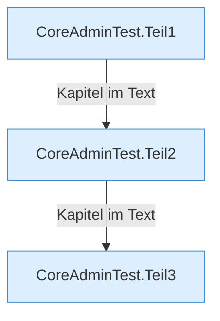

[[00 Start]] › [[Tests]] › [[CoreAdminTest]]

# CoreAdminTest



```knoten
CoreAdminTest.Teil1
  Ein weiterer Abschnitt derselben Übersicht.
CoreAdminTest.Teil2
  Ein weiterer Abschnitt derselben Übersicht.
CoreAdminTest.Teil3
  Ein weiterer Abschnitt derselben Übersicht.
```

> [!knoten] Was die Blöcke tun
> - **CoreAdminTest.Teil1**: Ein weiterer Abschnitt derselben Übersicht.
> - **CoreAdminTest.Teil2**: Ein weiterer Abschnitt derselben Übersicht.
> - **CoreAdminTest.Teil3**: Ein weiterer Abschnitt derselben Übersicht.

- [[Glossar#Probelauf|Probelauf]] für die [[Glossar#Befehl|Befehle]] der Verwaltung.
