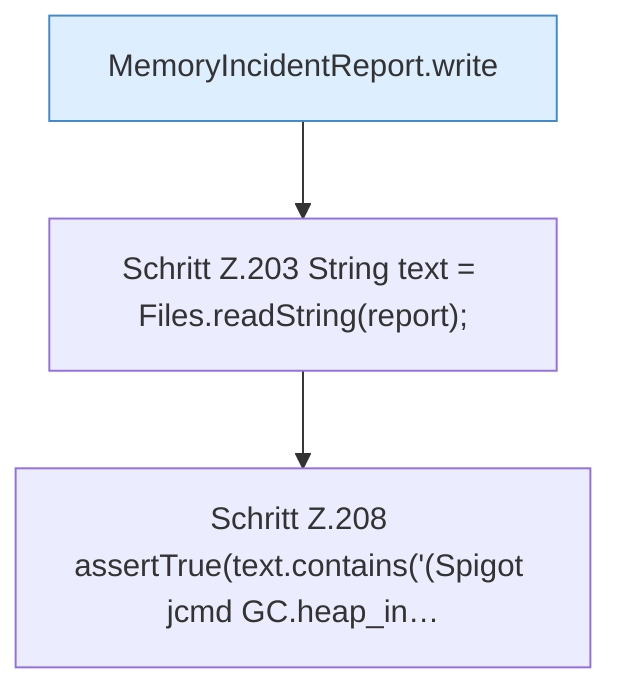

[[00 Start]] › [[Tests]] › [[CoreAdminTest]] › [[CoreAdminTest.Teil2]] › [[CoreAdminTest.memoryIncidentReportWritesTimelineFactsAndReadOnlyDiagnostics]]

# CoreAdminTest.memoryIncidentReportWritesTimelineFactsAndReadOnlyDiagnostics

`CoreAdminTest.memoryIncidentReportWritesTimelineFactsAndReadOnlyDiagnostics()` [src/test/java/de/aichele/childlauncher/CoreAdminTest.java:195–209](https://github.com/Sciddie/minecraft-serverhoster-plugin/blob/95b02b953b0b4c23673e900e021a7c3c844aa37d/src/test/java/de/aichele/childlauncher/CoreAdminTest.java#L195-L209)



```knoten
MemoryIncidentReport.write
  Schreibt `write`. Ruft `cgroupUsePercent`.
Schritt Z.203 String text = Files.readString(report);
  Zeile 203: liest Text aus einer Datei. `String text = Files.readString(report);`
Schritt Z.208 assertTrue(text.contains('(Spigot jcmd GC.heap_in…
  Zeile 208: fragt jcmd. `assertTrue(text.contains('(Spigot jcmd GC.heap_in…`
```

- `memoryIncidentReportWritesTimelineFactsAndReadOnlyDiagnostics` in `src/test/java/de/aichele/childlauncher/CoreAdminTest.java`
- Auslöser: Test
