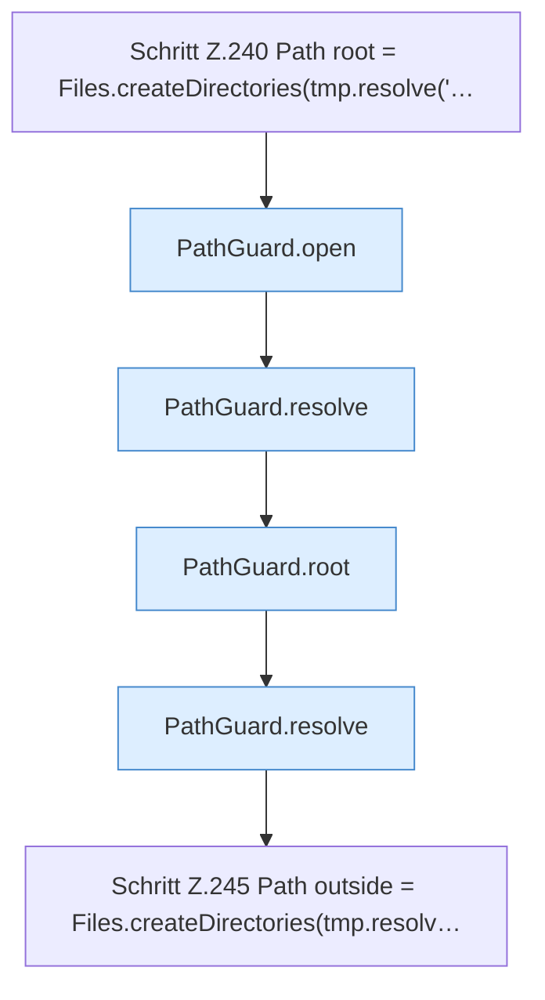

[[00 Start]] › [[Tests]] › [[CoreAdminTest]] › [[CoreAdminTest.Teil2]] › [[CoreAdminTest.pathGuardRejectsEscapeAndSymlink]] › [[CoreAdminTest.pathGuardRejectsEscapeAndSymlink.Teil1]]

# CoreAdminTest.pathGuardRejectsEscapeAndSymlink.Teil1



```knoten
Schritt Z.240 Path root = Files.createDirectories(tmp.resolve('…
  Zeile 240: Dateioperation. `Path root = Files.createDirectories(tmp.resolve('…`
PathGuard.open
  Dieser Teil öffnet das. Öffnet `open`. Ruft `PathGuard`.
PathGuard.resolve
  Dieser Teil bestimmt das. Löst auf `resolve`.
PathGuard.root
  Dieser Teil macht hier einen einzelnen Schritt. Eine Ebene tiefer steht er genauer. Liefert die Wurzel `root`.
Schritt Z.245 Path outside = Files.createDirectories(tmp.resolv…
  Zeile 245: Dateioperation. `Path outside = Files.createDirectories(tmp.resolv…`
```

> [!knoten]- Was die Blöcke tun
> - **Schritt Z.240 Path root = Files.createDirectories(tmp.resolve('…**: Zeile 240: Dateioperation. `Path root = Files.createDirectories(tmp.resolve('…`
> - **PathGuard.open**: Dieser Teil öffnet das. Öffnet `open`. Ruft `PathGuard`.
> - **PathGuard.resolve**: Dieser Teil bestimmt das. Löst auf `resolve`.
> - **PathGuard.root**: Dieser Teil macht hier einen einzelnen Schritt. Eine Ebene tiefer steht er genauer. Liefert die Wurzel `root`.
> - **Schritt Z.245 Path outside = Files.createDirectories(tmp.resolv…**: Zeile 245: Dateioperation. `Path outside = Files.createDirectories(tmp.resolv…`

- Ein weiterer Abschnitt derselben Übersicht.
- Fortsetzung von `CoreAdminTest.pathGuardRejectsEscapeAndSymlink`.
