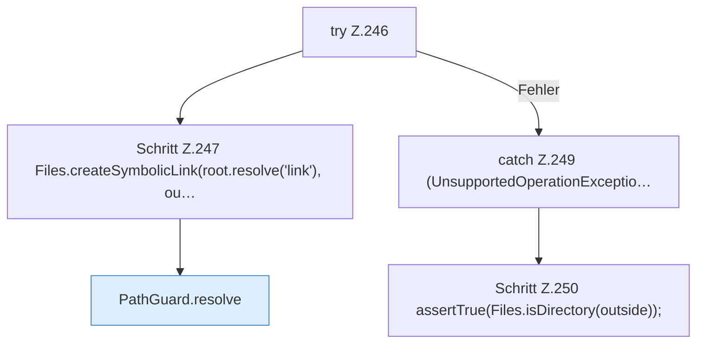

[[00 Start]] › [[Tests]] › [[CoreAdminTest]] › [[CoreAdminTest.Teil2]] › [[CoreAdminTest.pathGuardRejectsEscapeAndSymlink]] › [[CoreAdminTest.pathGuardRejectsEscapeAndSymlink.Teil2]]

# CoreAdminTest.pathGuardRejectsEscapeAndSymlink.Teil2

- Fortsetzung von `CoreAdminTest.pathGuardRejectsEscapeAndSymlink`, Quellreihenfolge.
