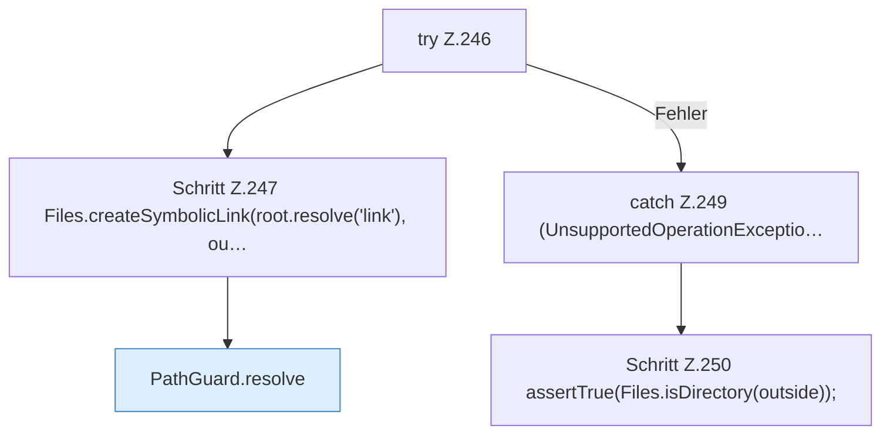

[[00 Start]] › [[Tests]] › [[CoreAdminTest]] › [[CoreAdminTest.Teil2]] › [[CoreAdminTest.pathGuardRejectsEscapeAndSymlink]] › [[CoreAdminTest.pathGuardRejectsEscapeAndSymlink.Teil2]]

# CoreAdminTest.pathGuardRejectsEscapeAndSymlink.Teil2



```knoten
try Z.246
  Zeile 246: Versuch. Der Fehlerpfad geht in catch.
Schritt Z.247 Files.createSymbolicLink(root.resolve('link'), ou…
  Zeile 247: Dateioperation. `Files.createSymbolicLink(root.resolve('link'), ou…`
PathGuard.resolve
  Löst auf `resolve`.
catch Z.249 (UnsupportedOperationExceptio…
  Zeile 249: fängt (UnsupportedOperationExceptio….
Schritt Z.250 assertTrue(Files.isDirectory(outside));
  Zeile 250: Dateioperation. `assertTrue(Files.isDirectory(outside));`
```

- Fortsetzung von `CoreAdminTest.pathGuardRejectsEscapeAndSymlink`, Quellreihenfolge.
