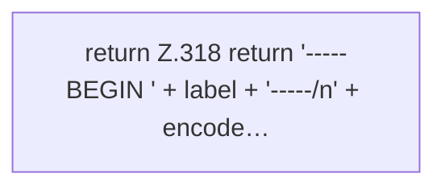

[[00 Start]] › [[Tests]] › [[CoreAdminTest]] › [[CoreAdminTest.Teil3]] › [[CoreAdminTest.pem]]

# CoreAdminTest.pem

`CoreAdminTest.pem(String label, byte[] der)` [src/test/java/de/aichele/childlauncher/CoreAdminTest.java:316–319](https://github.com/Sciddie/minecraft-serverhoster-plugin/blob/95b02b953b0b4c23673e900e021a7c3c844aa37d/src/test/java/de/aichele/childlauncher/CoreAdminTest.java#L316-L319)



```knoten
return Z.318 return '-----BEGIN ' + label + '-----/n' + encode…
  Zeile 318: Rückgabe `return '-----BEGIN ' + label + '-----/n' + encode…`.
```

> [!knoten]- Was die Blöcke tun
> - **return Z.318 return '-----BEGIN ' + label + '-----/n' + encode…**: Zeile 318: Rückgabe `return '-----BEGIN ' + label + '-----/n' + encode…`.

- Ein Schritt in einem [[Glossar#Probelauf|Probelauf]]. Er gehört nicht zum laufenden Server.
- `pem` in `src/test/java/de/aichele/childlauncher/CoreAdminTest.java`
- Das ist ein Probelauf, kein Teil des laufenden Servers.
