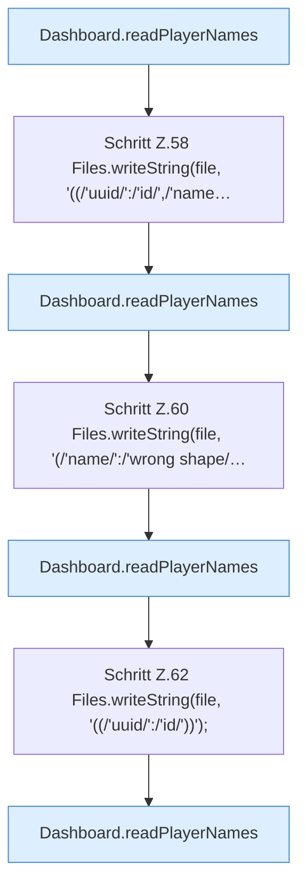

[[00 Start]] › [[Tests]] › [[CoreAdminTest]] › [[CoreAdminTest.Teil1]] › [[CoreAdminTest.playerListsReportInvalidJsonInsteadOfPretendingToBeEmpty]]

# CoreAdminTest.playerListsReportInvalidJsonInsteadOfPretendingToBeEmpty

`CoreAdminTest.playerListsReportInvalidJsonInsteadOfPretendingToBeEmpty()` [src/test/java/de/aichele/childlauncher/CoreAdminTest.java:55–64](https://github.com/Sciddie/minecraft-serverhoster-plugin/blob/95b02b953b0b4c23673e900e021a7c3c844aa37d/src/test/java/de/aichele/childlauncher/CoreAdminTest.java#L55-L64)



```knoten
Dashboard.readPlayerNames
  Die [[Glossar#Web-Schnittstelle|Web-Schnittstelle]] liest den [[Glossar#Spieler|Spieler]] die Namen. Liest `readPlayerNames`.
Schritt Z.58 Files.writeString(file, '((/'uuid/':/'id/',/'name…
  Zeile 58: schreibt Text in eine Datei. `Files.writeString(file, '((/'uuid/':/'id/',/'name…`
Schritt Z.60 Files.writeString(file, '(/'name/':/'wrong shape/…
  Zeile 60: schreibt Text in eine Datei. `Files.writeString(file, '(/'name/':/'wrong shape/…`
Schritt Z.62 Files.writeString(file, '((/'uuid/':/'id/'))');
  Zeile 62: schreibt Text in eine Datei. `Files.writeString(file, '((/'uuid/':/'id/'))');`
```

> [!knoten]- Was die Blöcke tun
> - **Dashboard.readPlayerNames**: Die [[Glossar#Web-Schnittstelle|Web-Schnittstelle]] liest den [[Glossar#Spieler|Spieler]] die Namen. Liest `readPlayerNames`.
> - **Schritt Z.58 Files.writeString(file, '((/'uuid/':/'id/',/'name…**: Zeile 58: schreibt Text in eine Datei. `Files.writeString(file, '((/'uuid/':/'id/',/'name…`
> - **Schritt Z.60 Files.writeString(file, '(/'name/':/'wrong shape/…**: Zeile 60: schreibt Text in eine Datei. `Files.writeString(file, '(/'name/':/'wrong shape/…`
> - **Schritt Z.62 Files.writeString(file, '((/'uuid/':/'id/'))');**: Zeile 62: schreibt Text in eine Datei. `Files.writeString(file, '((/'uuid/':/'id/'))');`

- Ein Schritt in einem [[Glossar#Probelauf|Probelauf]]. Er gehört nicht zum laufenden Server.
- `playerListsReportInvalidJsonInsteadOfPretendingToBeEmpty` in `src/test/java/de/aichele/childlauncher/CoreAdminTest.java`
- Das ist ein Probelauf, kein Teil des laufenden Servers.
