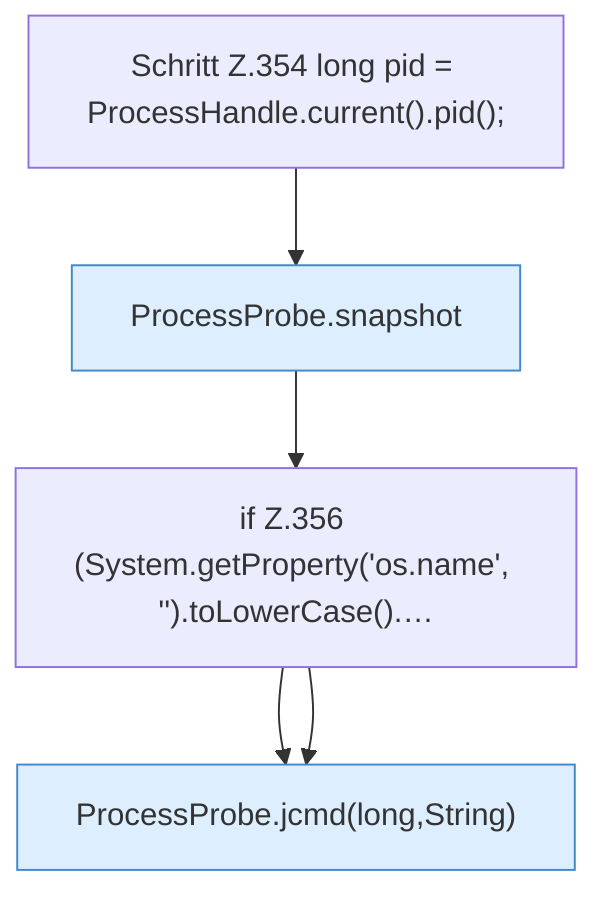

[[00 Start]] › [[Tests]] › [[CoreAdminTest]] › [[CoreAdminTest.Teil3]] › [[CoreAdminTest.probeAndIndexContract]] › [[CoreAdminTest.probeAndIndexContract.Teil1]]

# CoreAdminTest.probeAndIndexContract.Teil1

- Fortsetzung von `CoreAdminTest.probeAndIndexContract`, Quellreihenfolge.
