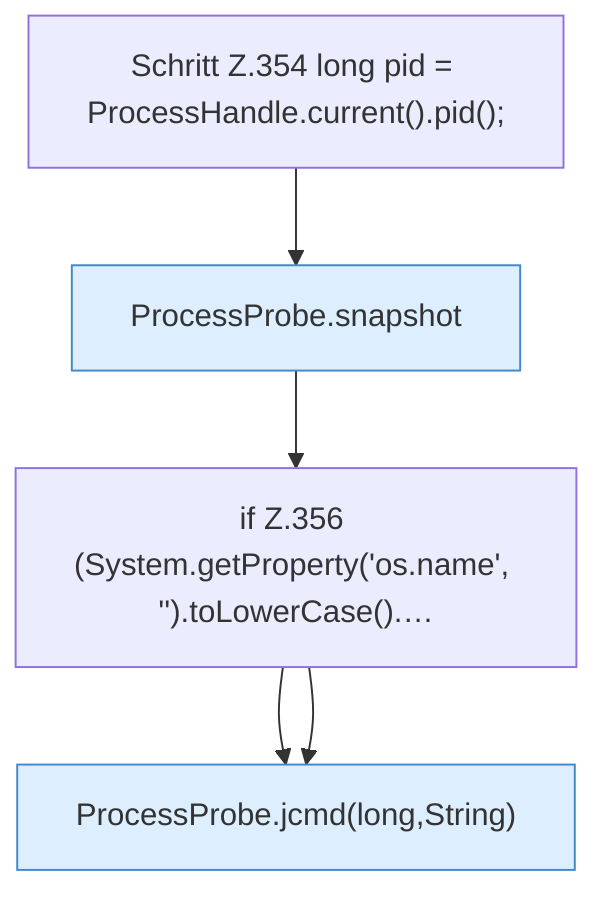

[[00 Start]] › [[Tests]] › [[CoreAdminTest]] › [[CoreAdminTest.Teil3]] › [[CoreAdminTest.probeAndIndexContract]] › [[CoreAdminTest.probeAndIndexContract.Teil1]]

# CoreAdminTest.probeAndIndexContract.Teil1



```knoten
Schritt Z.354 long pid = ProcessHandle.current().pid();
  Zeile 354: fragt den Prozess ab. `long pid = ProcessHandle.current().pid();`
ProcessProbe.snapshot
  Dieser Teil macht hier einen einzelnen Schritt. Eine Ebene tiefer steht er genauer. `snapshot` in `ProcessProbe.java`. Ruft `kb`.
if Z.356 (System.getProperty('os.name', '').toLowerCase().…
  Zeile 356: prüft `(System.getProperty('os.name', '').toLowerCase().…`.
ProcessProbe.jcmd(long,String)
  Dieser Teil macht hier einen einzelnen Schritt. Eine Ebene tiefer steht er genauer. `jcmd` in `ProcessProbe.java`. Ruft `jcmd`.
```

> [!knoten]- Was die Blöcke tun
> - **Schritt Z.354 long pid = ProcessHandle.current().pid();**: Zeile 354: fragt den Prozess ab. `long pid = ProcessHandle.current().pid();`
> - **ProcessProbe.snapshot**: Dieser Teil macht hier einen einzelnen Schritt. Eine Ebene tiefer steht er genauer. `snapshot` in `ProcessProbe.java`. Ruft `kb`.
> - **if Z.356 (System.getProperty('os.name', '').toLowerCase().…**: Zeile 356: prüft `(System.getProperty('os.name', '').toLowerCase().…`.
> - **ProcessProbe.jcmd(long,String)**: Dieser Teil macht hier einen einzelnen Schritt. Eine Ebene tiefer steht er genauer. `jcmd` in `ProcessProbe.java`. Ruft `jcmd`.

- Ein weiterer Abschnitt derselben Übersicht.
- Fortsetzung von `CoreAdminTest.probeAndIndexContract`.
