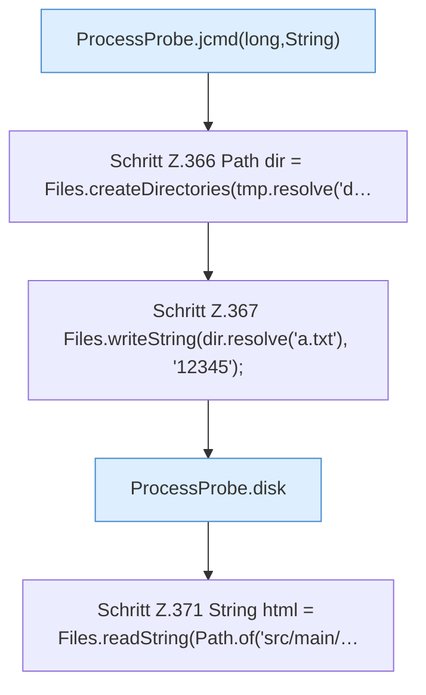

[[00 Start]] › [[Tests]] › [[CoreAdminTest]] › [[CoreAdminTest.Teil3]] › [[CoreAdminTest.probeAndIndexContract]] › [[CoreAdminTest.probeAndIndexContract.Teil2]]

# CoreAdminTest.probeAndIndexContract.Teil2



```knoten
ProcessProbe.jcmd(long,String)
  `jcmd` in `ProcessProbe.java`. Ruft `jcmd`.
Schritt Z.366 Path dir = Files.createDirectories(tmp.resolve('d…
  Zeile 366: Dateioperation. `Path dir = Files.createDirectories(tmp.resolve('d…`
Schritt Z.367 Files.writeString(dir.resolve('a.txt'), '12345');
  Zeile 367: schreibt Text in eine Datei. `Files.writeString(dir.resolve('a.txt'), '12345');`
ProcessProbe.disk
  Liest die Platte `disk`.
Schritt Z.371 String html = Files.readString(Path.of('src/main/…
  Zeile 371: liest Text aus einer Datei. `String html = Files.readString(Path.of('src/main/…`
```

- Fortsetzung von `CoreAdminTest.probeAndIndexContract`, Quellreihenfolge.
