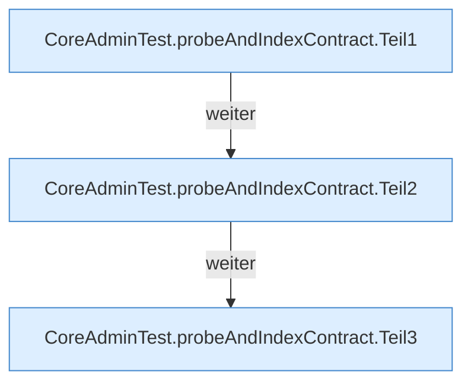

[[00 Start]] › [[Tests]] › [[CoreAdminTest]] › [[CoreAdminTest.Teil3]] › [[CoreAdminTest.probeAndIndexContract]]

# CoreAdminTest.probeAndIndexContract

`CoreAdminTest.probeAndIndexContract()` [src/test/java/de/aichele/childlauncher/CoreAdminTest.java:353–379](https://github.com/Sciddie/minecraft-serverhoster-plugin/blob/95b02b953b0b4c23673e900e021a7c3c844aa37d/src/test/java/de/aichele/childlauncher/CoreAdminTest.java#L353-L379)



```knoten
CoreAdminTest.probeAndIndexContract.Teil1
  Ein weiterer Abschnitt derselben Übersicht. Abschnitt 1 dieses Ablaufs, in Quellreihenfolge.
CoreAdminTest.probeAndIndexContract.Teil2
  Ein weiterer Abschnitt derselben Übersicht. Abschnitt 2 dieses Ablaufs, in Quellreihenfolge.
CoreAdminTest.probeAndIndexContract.Teil3
  Ein weiterer Abschnitt derselben Übersicht. Abschnitt 3 dieses Ablaufs, in Quellreihenfolge.
```

> [!knoten]- Was die Blöcke tun
> - **CoreAdminTest.probeAndIndexContract.Teil1**: Ein weiterer Abschnitt derselben Übersicht. Abschnitt 1 dieses Ablaufs, in Quellreihenfolge.
> - **CoreAdminTest.probeAndIndexContract.Teil2**: Ein weiterer Abschnitt derselben Übersicht. Abschnitt 2 dieses Ablaufs, in Quellreihenfolge.
> - **CoreAdminTest.probeAndIndexContract.Teil3**: Ein weiterer Abschnitt derselben Übersicht. Abschnitt 3 dieses Ablaufs, in Quellreihenfolge.

- Ein Schritt in einem [[Glossar#Probelauf|Probelauf]]. Er gehört nicht zum laufenden Server.
- `probeAndIndexContract` in `src/test/java/de/aichele/childlauncher/CoreAdminTest.java`
- Das ist ein Probelauf, kein Teil des laufenden Servers.
