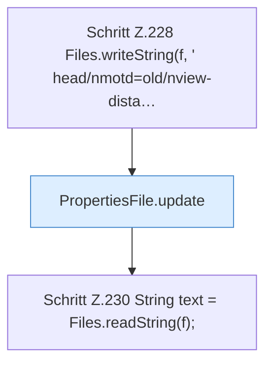

[[00 Start]] › [[Tests]] › [[CoreAdminTest]] › [[CoreAdminTest.Teil2]] › [[CoreAdminTest.propertiesKeepCommentsAndForeignKeys]]

# CoreAdminTest.propertiesKeepCommentsAndForeignKeys

`CoreAdminTest.propertiesKeepCommentsAndForeignKeys()` [src/test/java/de/aichele/childlauncher/CoreAdminTest.java:226–237](https://github.com/Sciddie/minecraft-serverhoster-plugin/blob/95b02b953b0b4c23673e900e021a7c3c844aa37d/src/test/java/de/aichele/childlauncher/CoreAdminTest.java#L226-L237)



```knoten
Schritt Z.228 Files.writeString(f, ' head/nmotd=old/nview-dista…
  Zeile 228: schreibt Text in eine Datei. `Files.writeString(f, ' head/nmotd=old/nview-dista…`
PropertiesFile.update
  Aktualisiert `update`.
Schritt Z.230 String text = Files.readString(f);
  Zeile 230: liest Text aus einer Datei. `String text = Files.readString(f);`
```

- `propertiesKeepCommentsAndForeignKeys` in `src/test/java/de/aichele/childlauncher/CoreAdminTest.java`
- Auslöser: Test
