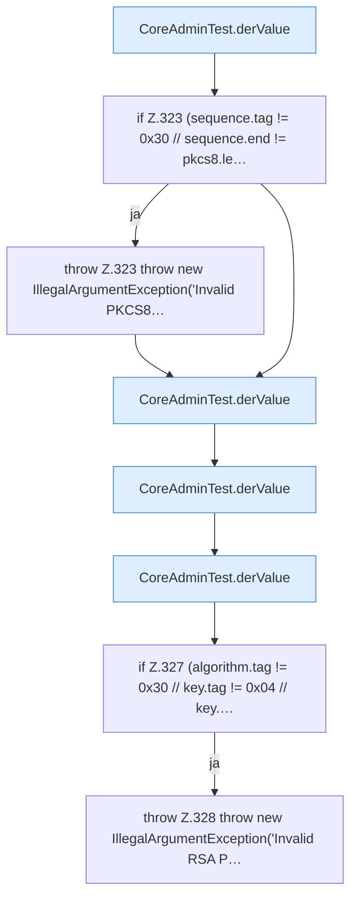

[[00 Start]] › [[Tests]] › [[CoreAdminTest]] › [[CoreAdminTest.Teil3]] › [[CoreAdminTest.rsaPkcs1]] › [[CoreAdminTest.rsaPkcs1.Teil1]]

# CoreAdminTest.rsaPkcs1.Teil1

- Fortsetzung von `CoreAdminTest.rsaPkcs1`, Quellreihenfolge.
