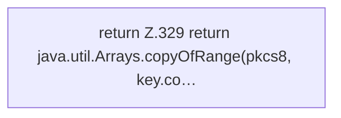

[[00 Start]] › [[Tests]] › [[CoreAdminTest]] › [[CoreAdminTest.Teil3]] › [[CoreAdminTest.rsaPkcs1]] › [[CoreAdminTest.rsaPkcs1.Teil2]]

# CoreAdminTest.rsaPkcs1.Teil2



```knoten
return Z.329 return java.util.Arrays.copyOfRange(pkcs8, key.co…
  Zeile 329: Rückgabe `return java.util.Arrays.copyOfRange(pkcs8, key.co…`.
```

- Fortsetzung von `CoreAdminTest.rsaPkcs1`, Quellreihenfolge.
