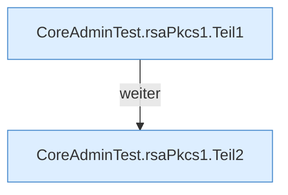

[[00 Start]] › [[Tests]] › [[CoreAdminTest]] › [[CoreAdminTest.Teil3]] › [[CoreAdminTest.rsaPkcs1]]

# CoreAdminTest.rsaPkcs1

`CoreAdminTest.rsaPkcs1(byte[] pkcs8)` [src/test/java/de/aichele/childlauncher/CoreAdminTest.java:321–330](https://github.com/Sciddie/minecraft-serverhoster-plugin/blob/95b02b953b0b4c23673e900e021a7c3c844aa37d/src/test/java/de/aichele/childlauncher/CoreAdminTest.java#L321-L330)



```knoten
CoreAdminTest.rsaPkcs1.Teil1
  Abschnitt 1 dieses Ablaufs, in Quellreihenfolge.
CoreAdminTest.rsaPkcs1.Teil2
  Abschnitt 2 dieses Ablaufs, in Quellreihenfolge.
```

- `rsaPkcs1` in `src/test/java/de/aichele/childlauncher/CoreAdminTest.java`
- Auslöser: Test
