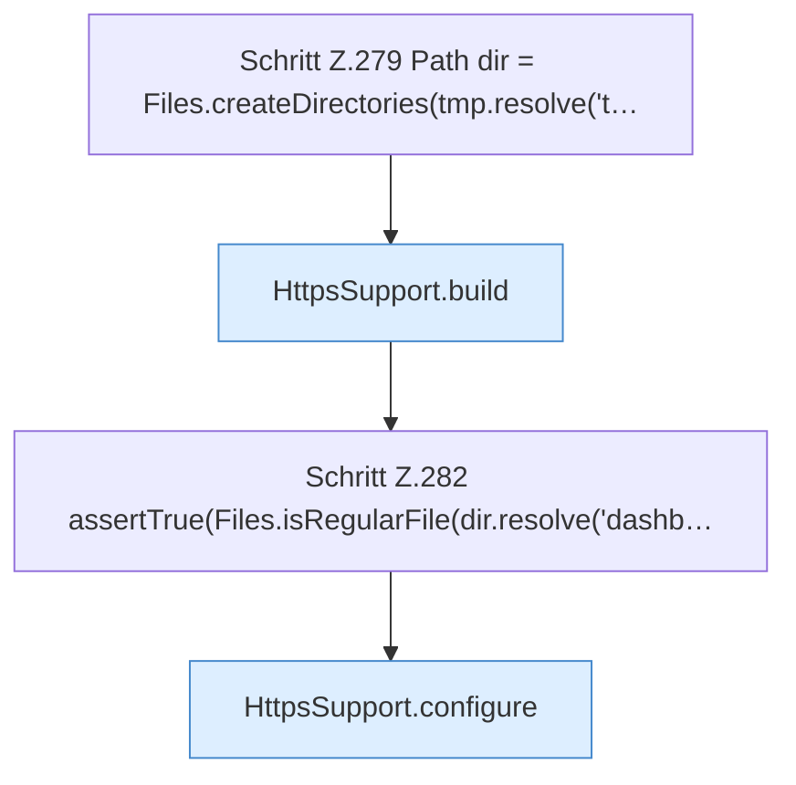

[[00 Start]] › [[Tests]] › [[CoreAdminTest]] › [[CoreAdminTest.Teil3]] › [[CoreAdminTest.selfSignedHandshakeAndPem]] › [[CoreAdminTest.selfSignedHandshakeAndPem.Teil1]]

# CoreAdminTest.selfSignedHandshakeAndPem.Teil1

- Fortsetzung von `CoreAdminTest.selfSignedHandshakeAndPem`, Quellreihenfolge.
