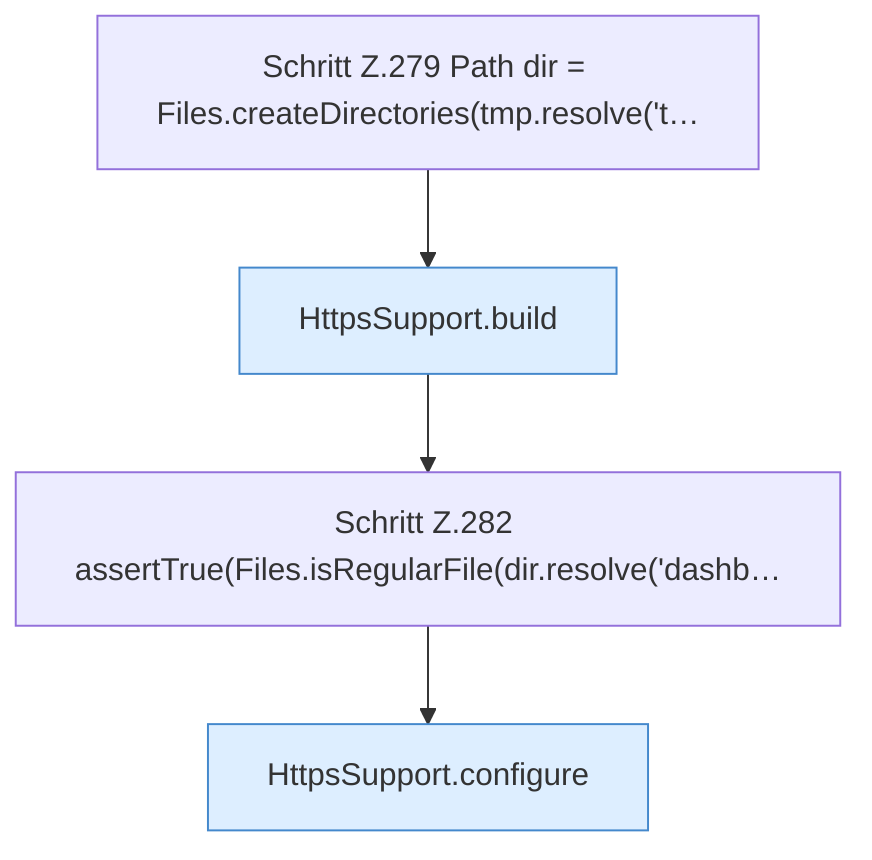

[[00 Start]] › [[Tests]] › [[CoreAdminTest]] › [[CoreAdminTest.Teil3]] › [[CoreAdminTest.selfSignedHandshakeAndPem]] › [[CoreAdminTest.selfSignedHandshakeAndPem.Teil1]]

# CoreAdminTest.selfSignedHandshakeAndPem.Teil1



```knoten
Schritt Z.279 Path dir = Files.createDirectories(tmp.resolve('t…
  Zeile 279: Dateioperation. `Path dir = Files.createDirectories(tmp.resolve('t…`
HttpsSupport.build
  Dieser Teil baut das. Baut `build`. Ruft `fromKeystore`, `ensureSelfSigned`, `password`.
Schritt Z.282 assertTrue(Files.isRegularFile(dir.resolve('dashb…
  Zeile 282: Dateioperation. `assertTrue(Files.isRegularFile(dir.resolve('dashb…`
HttpsSupport.configure
  Dieser Teil macht hier einen einzelnen Schritt. Eine Ebene tiefer steht er genauer. `configure` in `HttpsSupport.java`. Ruft `configure`.
```

> [!knoten]- Was die Blöcke tun
> - **Schritt Z.279 Path dir = Files.createDirectories(tmp.resolve('t…**: Zeile 279: Dateioperation. `Path dir = Files.createDirectories(tmp.resolve('t…`
> - **HttpsSupport.build**: Dieser Teil baut das. Baut `build`. Ruft `fromKeystore`, `ensureSelfSigned`, `password`.
> - **Schritt Z.282 assertTrue(Files.isRegularFile(dir.resolve('dashb…**: Zeile 282: Dateioperation. `assertTrue(Files.isRegularFile(dir.resolve('dashb…`
> - **HttpsSupport.configure**: Dieser Teil macht hier einen einzelnen Schritt. Eine Ebene tiefer steht er genauer. `configure` in `HttpsSupport.java`. Ruft `configure`.

- Ein weiterer Abschnitt derselben Übersicht.
- Fortsetzung von `CoreAdminTest.selfSignedHandshakeAndPem`.
