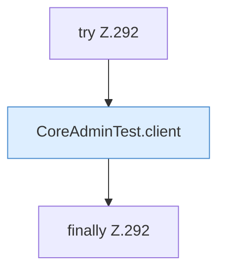

[[00 Start]] › [[Tests]] › [[CoreAdminTest]] › [[CoreAdminTest.Teil3]] › [[CoreAdminTest.selfSignedHandshakeAndPem]] › [[CoreAdminTest.selfSignedHandshakeAndPem.Teil2]]

# CoreAdminTest.selfSignedHandshakeAndPem.Teil2



```knoten
try Z.292
  Zeile 292: Versuch. Der Fehlerpfad geht in catch.
CoreAdminTest.client
  `client` in `CoreAdminTest.java`. Nur Test.
finally Z.292
  Läuft danach immer, auch nach einem Fehler.
```

- Fortsetzung von `CoreAdminTest.selfSignedHandshakeAndPem`, Quellreihenfolge.
